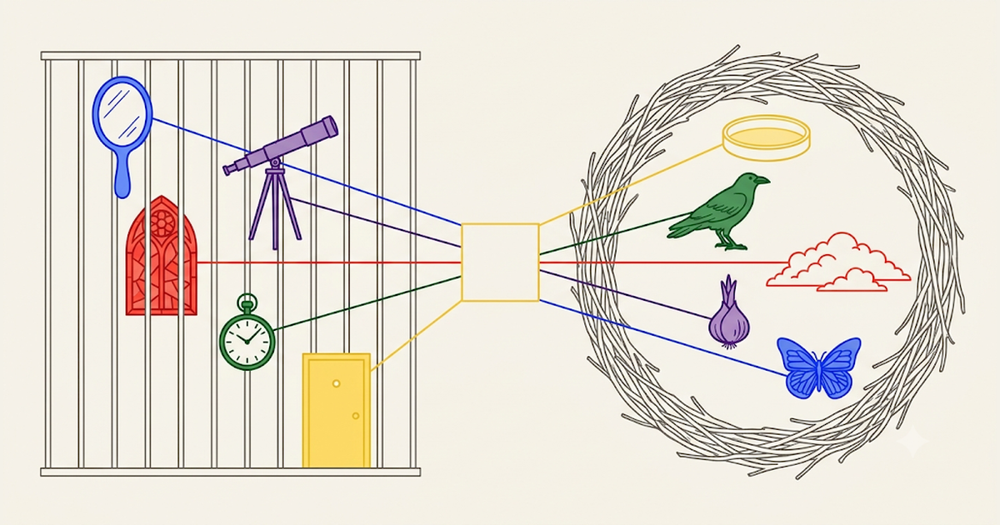

# 투향: Opening the Golden Cage

책 홈페이지: https://hyunjimoon.github.io/golden-cage-book/

> 왜 이른 자원이 창업을 가두는가 — 그리고 어떻게 그 새장을 *둥지*로 여는가.


<!-- 중심 상징 그림이 들어오면 아래 한 줄을 연다 (img/og_center.png · 1200x630)
<p align="center"></p> -->

---

## 한 비교 — 지를까, 말까

창업에서 묻는 건 늘 하나다. **지른다**인가 **멈춘다**인가. 어려운 건 고르는 게 아니라 **비교할 값**이다.

성공은 **다섯이 다 「예」 해야** 생긴다 — 손님 · 만드는 사람 · 돈 내는 사람 · 같이 일하는 사람, 그리고 나. 넷이 「예」라도 하나가 「아니오」면 0이다. 더해서 평균 내는 값이 아니라 **곱해서 나오는 값**이라, **가장 낮은 하나가 전부를 정한다.**

**갈등 여덟은 이 비교가 틀어지는 여덟 가지 방식이다.**

| 틀어지는 방식 | 무슨 일이 나나 | 몇 | 누가 고쳐 주나 |
|:--|:--|:--:|:--|
| **저쪽을 안 봤다** | 덜 봤거나(표본 하나) · 그쪽 자를 안 봤거나 · 그쪽이 원하는 걸 안 봤다 | 4 | **그 사람이** — 들은 말이라 교정이 돌아온다 |
| **저쪽을 내 걸로 지어냈다** | 안 물어보고 내 대답을 그 자리에 적었다 | 3 | **아무도** — 내가 한 말이라 안 돌아온다 |
| **둘이 같다** | 지르나 멈추나 값이 같아 고를 수 없다 | 1 | **나 자신** — 101호 |

| 들은 말 | 틀어지는 방식 | 그래서 뭘 하나 | 어디로 |
|:--|:--|:--|:--|
| "내가 1호 고객입니다" | 저쪽을 안 봤다 | 내가 안 써도 **매일 켜는 사람 한 명**을 찾는다 | 1장 → **6장** |
| "데모는 돌았다" | 저쪽을 안 봤다 | 돈 조건을 **세 줄**로 적고, 양산에서 깨질 줄에 먼저 건다 | 2장 → **7장** |
| "좋은데, 지금은 아니고" | 저쪽을 안 봤다 | 거절로 적지 말고 **조건으로** 적는다 — 무엇이 참이면 「지금」인가 | 3장 → **8장** |
| "눈금이 다르다" | 저쪽을 안 봤다 | 값을 맞추기 전에 **자를 맞춘다** | 4장 → **9장** |
| "원하니까 됩니다" | 저쪽을 내 걸로 지어냈다 | 되는 조건을 **기술자 손으로** 쓰게 한다 | 건너뛴 **2장**으로 |
| "알아보면 투자합니다" | 저쪽을 내 걸로 지어냈다 | 「못 알아본다」를 적기 전에 **내 설득을 한 번 고쳐 쓴다** | 건너뛴 **3장**으로 |
| "내 꿈이 네 KPI" | 저쪽을 내 걸로 지어냈다 | 내 꿈을 **상대 자로 번역**하기 전에는 KPI로 내리지 않는다 | 건너뛴 **4장**으로 |
| "지른 나, 막는 나" | 둘이 같다 | 지른 약속을 **장부에 적고 한 번 멈춘다** | **5장 ↔ 10장** |

> **실측** — 남의 창업기·성장기 99곳 중 날짜로 특정된 25곳에서 여덟이 다 나왔다. 「남의 값을 지어냈다」 셋은 **전부 내가 한 말**이었고, 내가 한 말 일곱 중 다섯이 실패·논란으로 끝났다. **들은 말에는 교정이 오고, 한 말에는 오지 않는다.**
> **「안 봤다」가 셋을 접고 있다** — 덜 본 것(「데모는 돌았다」: 한 번 돈 것과 천 번 도는 것을 같다고 셌다) · 그쪽 자를 안 본 것(「눈금이 다르다」) · 그쪽 값을 안 본 것. 결정의 이음매로는 셋이지만 **창업자가 할 일은 하나**라 한 칸에 둔다.
> **괴로움은 마지막 줄에서 가장 크다.** 한쪽이 분명히 나으면 안 갈등한다. 저울이 안 기울 때 찢긴다 — 그 자리가 101호이고, 5장의 지침이 「밀리기 전에 뛰어내려라」인 이유다.

## 한 문장

창업가가 **자기를 설득하며 지은 새장**(1–4장)을, **101호**(5장)에서 한 번 멈춰 세고, **중심을 지나 뒤집어** **이해관계자를 이해하는 둥지**(6–9장)로 바꾼 뒤 제자리에서 닫는(10장) — **열 장짜리 창업 소설**.

> 변환은 **점 반전(−I)이지 회전이 아니다.** 거울짝 다섯(1↔6 · 2↔7 · 3↔8 · 4↔9 · 5↔10)의 중점이 **한 점(101호)**에서 만나는 것이 그 증명이다.
> 짝마다 바뀌는 것은 **한 축 위의 한 항**뿐이다 — 믿음 → **실험**(6장) · 관조 → **분포**(7장) · 확신 → **협상**(8장) · 작란 → **명명**(9장). 일연이 *正*을 *遺*로 비튼 것과 같은 크기의 변경이다.
> *쓰는 법*은 소설이 아니라 부록이 맡는다(부록 3 「한글같은 삶소설」).

## 핵심 방정식

```
dG/dF = (dG/dR) × (dR/dF) = (+) × (−) = (−)
```

방향전환(R)이 성장(G)을 만들지만, 자원(F)이 방향전환 억압. 미국 벤처 168,011건 실증 — 방향 바꾼 자(Movers)가 머문 자(Stayers)보다 **2.60배** 성장.

## 열 장 — 비교를 고치는 복도

『투향』은 한 장마다 **문학의 은유**로 갇힘을 진단하고 **운영의 수(數)**로 그 진단을 보정한다. 위 표가 **입구**(내가 들은 말로 나를 찾는 곳)라면, 아래 표는 **복도**다 — 무엇을 빌렸고 누가 그것을 되재는가.

| 장 | 극 | 작품 · 인물 | 묻는 것 → 바뀌는 것 |
| :--- | :--- | :--- | :--- |
| **1 🪞 거울새장** | **D** 욕망 | 036 마담 보바리 · 엠마 | 이 욕망은 빌린 것인가? → 빌린 욕망을 **센 다** |
| **2 🔭 망원경새장** | **+B** 믿음 | 456 표범 · 살리나 | 관조가 안 움직일 알리바이가 되었나? → 빌린 품위를 **센 다** |
| **3 💒 스테인굴레스새장** | **+A** 행동 | 267 페스트 · 파늘루 | 되물음을 모욕으로 받나? → 빌린 확신을 **센 다** |
| **4 ⏱️ 시계새장** | **+M** 자 | 091 방드르디 · 로빈슨 | 정사(正史)에 묶여 유사(遺事)를 흘리나? → 빌린 질서를 **센 다** |
| **5 🐀 101₂호** | **·점** | 077 1984 · 윈스턴 · 다 | 빚의 장부를 펴고 멈추었나? → 기대던 자리가 사라져 **모른 다** · **빚을 쓴다** |
| **6 🦋 나비둥지** | **D** · 🦋 사용자 | M. Butterfly *(전집 밖)* · 송 릴링 | 매일 자발로 켜는가? → 사용자가 고쳐 줘 **안 다** |
| **7 🧅 튤립둥지** | **B** · 🧅 기술자 | 268 검은 튤립 · 코르넬리우스 | 한 점 아닌 세 자리에 걸었나? → 기술자가 고쳐 줘 **안 다** |
| **8 🌫️ 안개둥지** | **A** · 🌫️ 투자자 | 121 안개 · 아우구스토 | 미래의 선택지를 지우지 않게 버티나? → 투자자가 고쳐 줘 **안 다** |
| **9 🐦‍⬛ 까마귀둥지** | **M** · 🐦‍⬛ 협력자 | 166 삼국유사 · 일연 | 값이 아니라 자(尺)를 함께 보나? → 협력자가 고쳐 줘 **안 다** |
| **10 🧫 101₃호** | **↗향** | — *(소설 없음)* · 세다 | 다음 사람이 자기 이름으로 주울 자리를 비웠나? → 제 자로 **세다** · **빚을 갚는다** |

> **깔때기 둘, 사건 둘** — 1\~4 깔때기 Ⅰ·새장 · **5 사건** · 6\~9 깔때기 Ⅱ·둥지 · **10 사건**. 모양이 같고 끝이 다르다 — 5장의 하나는 **닫히고**(위임 실패), 10장의 하나는 **셋으로 갈린다**(위임 성공). 5·10장은 칸이 아니라 **자리 수**라 두 행만 셋째 칸(빚을 쓴다/갚는다)을 더 받는다.
> **극이 곧 거울짝이다** — **D** 1↔6 🦋 · **B** 2↔7 🧅 · **A** 3↔8 🌫️ · **M** 4↔9 🐦‍⬛ · 회전축 5↔10. 1부는 네 극을 **쌓고**(D → +B → +A → +M), 2부가 거기에 짝을 하나씩 붙여 **축**을 세운다. 그래서 짝의 앞쪽은 *나에게* 묻고, 뒤쪽은 같은 물음을 *이해관계자에게* 되묻는다 — 이해관계자는 2부의 산출물이라 1~4장 행에는 서지 않는다. ⚠️ **둘째 칸은 쌓는 순서이고 넷째 칸은 그 장의 소재다** — 1행만 낱말이 같고(욕망→욕망) 2·3·4행은 다르다(믿음→품위 · 행동→확신 · 자→질서).
> **여덟 장 × 4칸(경험·지식·사례·실천) = 32칸에 빈칸 0** — 2026-11-08 실측. 5·10장은 칸이 아니라 **자리 수**다([#45](https://github.com/hyunjimoon/golden-cage-book/issues/45)). 2·3·4장의 §2 지식은 초고라 저자 검토 전이다. 비는 칸이 생기면 **채우지 않고 ⚓로 표시한다** — 빈칸은 산출물이고, 채점에서는 calibration gap(0점)이다.
> 재는 법 = [`RUBRIC.md`](RUBRIC.md). 렌즈당 0–3점 · 10장 × 4렌즈 × 3점 = **120점** — 채점은 **열 장 전부를 네 렌즈로** 보므로, 위 표의 극 배정과는 다른 자다.

> **핵심 이동 — 과거의 고통을 미래의 연료로.** 1–4장에서 *나에게* 한 진단(모르고 빌린 욕망·접어버린 가능성·그어버린 선·훔친 불)이, 6–9장에서 *이해관계자에게* 되쓰인다. 남을 이해하는 유일한 길은, 내가 먼저 그 새장에 갇혀봤다는 것. **상처가 렌즈가 된다.**

<details>
<summary><b>근거 — 저자 · 출판 · 논문 셋</b></summary>

**저자**: 문현지 (Angie Hyunji Moon) 
**출판**: 민음사 (검토 중)
**근거 논문**: 
1. [Golden Cage: Paradox of Early Funding and Growth](https://github.com/hyunjimoon/golden-cage-thesis) — MIT SM Thesis (2026), N = 168,011
> abstract: Flexibility predicts startup growth, yet the funding that enables growth systematically suppresses flexibility. The mechanism is belief-based sorting. When founders commit to specific strategies, investors who share those beliefs fund; skeptics self-select out. The resulting board lacks cognitive diversity to advocate pivots. I formalize this phenomena as golden cage theory: founders cannot reposition because governance lacks advocates for alternatives.

> Analyzing 168,011 U.S. ventures, I establish three empirical regularities. First, early funding predicts less repositioning. Second, repositioning predicts success. Third, the early funding and growth correlation varies systematically by industry: negative where dominant designs constrain exploration (e.g. Hardware and Mobility), neutral or positive where uncertainty releases the cage (Software and Quantum).

> Three contributions emerge. Empirically, the funding-growth paradox holds as a robust regularity across 168,011 ventures. Theoretically, belief-based sorting in governance explains why commitment and flexibility trade off. Prescriptively, founders can balance commitment and flexibility with the 3S framework: Scope (commit to thesis, not architecture—moderate breadth outperforms both extremes), Sequencing (stage capital from non-dilutive to thesisdriven VC, delaying governance lock-in until market signals clarify), and Synchronization (match capability investment to market validation, avoiding the traps of over-building or over-promising).

2. Optimal Ignorance: Designing Promise Precision to Convert Uncertainty into Adaptive Capacity (2025)
> abstract: Entrepreneurial ventures must calibrate promise precision—the specificity of external commitments that mobilize stakeholders yet constrain adaptation. Precision creates a fundamental tension: specific promises mobilize resources but kill adaptability; vague promises preserve options but repel stakeholders. This paper develops the Optimal Ignorance Level (OIL) framework that controls judgment and belief precision into one variable by formulating success probability as a random variable and objective value. The solution prescribes a threshold rule: maintain strategic ambiguity until value exceeds integration costs fourfold, then earn precision proportional to the square root of the value-to-cost ratio. The key intuition is that entrepreneurial ignorance, when honestly signaled through vague promises, preserves adaptive capacity. A comparative case (Tesla vs. Better Place) illustrates how trajectories of precision, value, and information integration cost align with the model’s predictions, while acknowledging contextual confounds.

3. STRAP-ping Stakeholders for Entrepreneurial Decision-Making (2025)
> abstract: Entrepreneurs face extreme uncertainty across multiple stakeholder domains, yet lack principled frameworks to coordinate these uncertainties efficiently. This research introduces STRAP (Strategic Threshold Resolution for Actionable Priorities), a decision framework built on a fundamental equivalence: systematically reducing uncertainty directly increases venture success probability. STRAP transforms entrepreneurship into a structured cycle of Perception (modeling stakeholder uncertainties using Bayesian logit models) and Action (selecting experiments that maximize information gain per resource unit). The framework explicitly maps venture attributes to stakeholder choice probabilities, quantifies uncertainty through information-theoretic entropy, and optimizes sequential action selection through a primal-dual formulation. My key contribution demonstrates that successful ventures should target the “bottleneck” uncertainty offering the highest uncertainty reduction per resource unit while balancing stakeholder thresholds through dual variables. Using Sublime Systems’ low-carbon cement commercialization as a case study, I demonstrate that STRAP-guided decision making achieves a I2% reduction in weighted uncertainty while meeting all stakeholder thresholds.
</details>

---

## 가치제안 — 알은 빼고, 둥지만 공유한다

완성된 제품(알)을 보여주는 대신, 사용자·기술자·투자자·협력자 *각자의 알*을 품을 수 있는 **빈 둥지**(가치제안서)를 공유한다. 둥지가 넷을 모두 품으면 — 책은 새장이 아니라 둥지가 된다.

## 방법 — 짓고 · 펼치고 · 내보내고 · 다시 못박다

이 책은 **Nail → Scale → Sail → re-Nail**의 규율로 쓰인다. 외부(독자·편집자)의 반응이 내 예측과 어긋난 자리를 덮지 않고, 그 오차를 설계로 되먹여 다시 못박는다(*보정, calibration*). 완성이 아니라 *보정*을 마쳤을 때, 함께 넓힐 자격이 생긴다.

## 함께 여실 분께 (예비 협력자)

- **편집·출판** — 원고를 독자의 "삶을 바꾸는 이야기"로 벼리는 생산과정
- **번역·해외진출** — 각 둥지 장이 그 작품의 언어권 시장으로 열리는 입구
- **AI 활용 제작** — 다중 에이전트로 외서검토·감정궤적·구조정합을 돕는 파이프라인

문의는 이슈 또는 저자에게. *하나로 접기 전에 옵션을 펼쳐 두는 편이, 결국 더 빨리 좋은 책에 닿는다고 믿습니다.*

## 디렉토리

```
chapters/       ch0 도입 · ch1–4 새장 · ch5 회전축 · ch6–9 둥지 · ch10 에필로그
appendices/     부록 (낭만의심 3부작 · 한글같은 삶소설 · 프롬프팅 예시 · 산업별 빚)
interactive/    인터랙티브 (주기율표, 감정궤적, 본문 뷰어)
docs/           CHANGELOG · INTENT
img/            다이어그램
```
---

*빌린 것을 갚으면, 새장이 둥지가 된다.*
