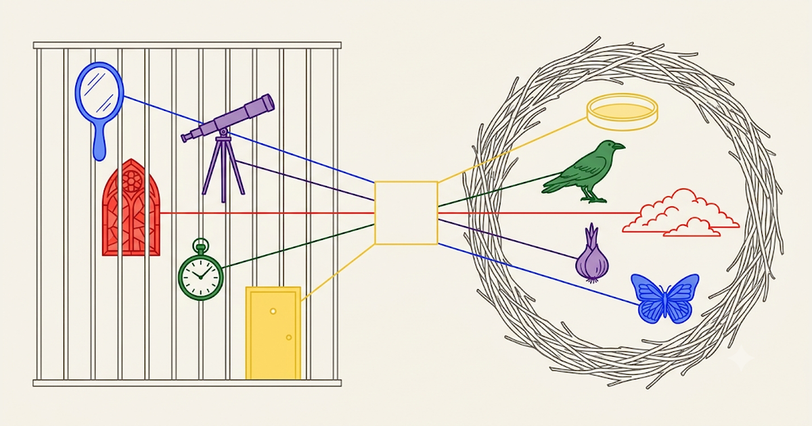

# 투향: Opening the Golden Cage

책 홈페이지: https://hyunjimoon.github.io/golden-cage-book/

> 왜 이른 자원이 창업을 가두는가 — 그리고 어떻게 그 새장을 *둥지*로 여는가.


<p align="center"></p>

---

## 당신은 지금 어디 서 있습니까

| | 묻는 것 | 이런 말이 나올 때 | 읽을 장 |
|:--:|:--|:--|:--|
| **1** | 이 원함이 내 것인가, 빌린 것인가 | *"저도 이게 필요해서 만들었어요"* | [1 거울 → 6 나비](https://hyunjimoon.github.io/golden-cage-book/interactive/reader.html?file=ch1_mirror_cage) |
| **2** | 다 알겠는데 왜 시작을 못 하나 | *"우리 시장은 원래…"* | [2 망원경 → 7 튤립구근](https://hyunjimoon.github.io/golden-cage-book/interactive/reader.html?file=ch2_telescope_cage) |
| **3** | 내 확신을 되물어 줄 사람이 있나 | **—** | [3 스테인굴레스 → 8 안개](https://hyunjimoon.github.io/golden-cage-book/interactive/reader.html?file=ch3_glass_cage) |
| **4** | 누구의 자로, 누구와 재나 | *"제 대시보드는 초록인데요"* | [4 시계 → 9 까마귀](https://hyunjimoon.github.io/golden-cage-book/interactive/reader.html?file=ch4_clock_cage) |
| **5** | 멈춰서 잃은 시간이 갚아지나 | *"제가 그렇게 말해버렸으니 어떻게든 해야죠"* | [5 101호 → 10 101호](https://hyunjimoon.github.io/golden-cage-book/interactive/reader.html?file=ch5_mirror_nest) |

화살표 앞이 갇히는 장, 뒤가 여는 장입니다. 아홉 편의 소설이 먼저 갇혔습니다 — 마담 보바리 · 표범 · 페스트 · 방드르디 · 1984 · M. Butterfly · 검은 튤립 · 안개 · 삼국유사.

3번 칸은 아직 못 들어서 비워 뒀습니다. 들으신 말이 있으면 알려주세요.

## 세 갈래

- **30초** — 위에서 당신 줄 하나
- **5분** — 그 줄의 장 하나
- **두 줄** — 그 말을 하고 무엇을 했는지 → [여기](https://github.com/hyunjimoon/golden-cage-book/issues/new)

<details>
<summary><b>여덟 마디 — 상대와 부딪힐 때 (위 다섯이 밖으로 나타나는 꼴)</b></summary>

#### 한 비교 — 지를까, 말까

창업에서 묻는 건 늘 하나다. **지른다**인가 **멈춘다**인가. 어려운 건 고르는 게 아니라 **비교할 값**이다.

성공은 **다섯이 다 「예」 해야** 생긴다 — 손님 · 만드는 사람 · 돈 내는 사람 · 같이 일하는 사람, 그리고 나. 넷이 「예」라도 하나가 「아니오」면 0이다. 더해서 평균 내는 값이 아니라 **곱해서 나오는 값**이라, **가장 낮은 하나가 전부를 정한다.**

**갈등 여덟은 이 비교가 틀어지는 여덟 가지 방식이다.**

| 틀어지는 방식 | 무슨 일이 나나 | 몇 | 누가 고쳐 주나 |
|:--|:--|:--:|:--|
| **저쪽을 안 봤다** | 덜 봤거나(표본 하나) · 그쪽 자를 안 봤거나 · 그쪽이 원하는 걸 안 봤다 | 4 | **그 사람이** — 들은 말이라 교정이 돌아온다 |
| **저쪽을 내 걸로 지어냈다** | 안 물어보고 내 대답을 그 자리에 적었다 | 3 | **아무도** — 내가 한 말이라 안 돌아온다 |
| **둘이 같다** | 지르나 멈추나 값이 같아 고를 수 없다 | 1 | **나 자신** — 101호 |

| 들은 말 | 틀어지는 방식 | 그래서 뭘 하나 | 어디로 |
|:--|:--|:--|:--|
| "내가 1호 고객입니다" | 저쪽을 안 봤다 | 내가 안 써도 **매일 켜는 사람 한 명**을 찾는다 | 1장 → **6장** |
| "데모는 돌았다" | 저쪽을 안 봤다 | 돈 조건을 **세 줄**로 적고, 양산에서 깨질 줄에 먼저 건다 | 2장 → **7장** |
| "좋은데, 지금은 아니고" | 저쪽을 안 봤다 | 거절로 적지 말고 **조건으로** 적는다 — 무엇이 참이면 「지금」인가 | 3장 → **8장** |
| "눈금이 다르다" | 저쪽을 안 봤다 | 값을 맞추기 전에 **자를 맞춘다** | 4장 → **9장** |
| "원하니까 됩니다" | 저쪽을 내 걸로 지어냈다 | 되는 조건을 **기술자 손으로** 쓰게 한다 | 건너뛴 **2장**으로 |
| "알아보면 투자합니다" | 저쪽을 내 걸로 지어냈다 | 「못 알아본다」를 적기 전에 **내 설득을 한 번 고쳐 쓴다** | 건너뛴 **3장**으로 |
| "내 꿈이 네 KPI" | 저쪽을 내 걸로 지어냈다 | 내 꿈을 **상대 자로 번역**하기 전에는 KPI로 내리지 않는다 | 건너뛴 **4장**으로 |
| "지른 나, 막는 나" | 둘이 같다 | 지른 약속을 **장부에 적고 한 번 멈춘다** | **5장 ↔ 10장** |

> **괴로움은 마지막 줄에서 가장 크다.** 한쪽이 분명히 나으면 안 갈등한다. 저울이 안 기울 때 찢긴다 — 그 자리가 101호이고, 5장의 지침이 「밀리기 전에 뛰어내려라」인 이유다.
</details>

## 한 문장

창업가가 **자기를 설득하며 지은 새장**(1–4장)을, **101호**(5장)에서 한 번 멈춰 세고, **중심을 지나 뒤집어** **넷과의 연대가 남는 둥지**(6–9장)로 바꾼 뒤 제자리에서 닫는(10장) — **열 장짜리 창업 소설**.

## 인물 셋 — 다 · 세 · 세다

| | 이름이 곧 병 | 무엇을 하나 |
|:--:|:--|:--|
| **다** | **원해서 믿는 것** | 너무 원해서 될 거라 믿어 버린다. 앞서 달리며 **빚을 쓴다** |
| **세** | **믿어서 안 원하는 것** | 안 될 거라 믿어서 원하지도 않는다. 지켜보며 **적는다** |
| **세다** | 둘에게서 **불순물을 뗀 이름** | 곁에 서서 **대신 세어 준다** |

다에게서 「원해서」를 떼면 *믿는 것*이 남고, 세에게서 「믿어서 안」을 떼면 *원하는 것*이 남습니다. 그 둘을 합친 것이 **세다**입니다 — 새 인물이 아니라 **덜어 낸 자리**입니다.

둘 다 제대로 세지 못합니다. 5장에서 다가 세를 쏜 자리에 **세다가 생기고**, 6–9장에서 **넷을 하나씩 만나** 곁에 서서 대신 세어 주다가, 10장에서 **다가 세다를 찢습니다** — 둘이 스스로 셀 수 있게 되었기 때문입니다. 끝에는 **둘만 남아 직접 셉니다.**

---

> 짝마다 바뀌는 것은 **한 축 위의 한 항**뿐이다 — 욕망 → **실험**(6장) · 한 점 → **분포**(7장) · 확신 → **협상**(8장) · 질서 → **명명**(9장). 일연이 *正*을 *遺*로 비튼 것과 같은 크기의 변경이다.
> *쓰는 법*은 소설이 아니라 부록이 맡는다(부록 3 「한글같은 삶소설」).

## 바닥 둘 — 재는 코드와 받치는 글

소설의 대사는 지어낸 것일 수도, 캐낸 것일 수도 있습니다. 독자는 그 둘을 못 가릅니다.
이 책은 **검증하지 않은 낭만이 어떻게 새장이 되는지**를 말합니다. 그러면 이 책 자신도 검증을 받아야 합니다. 그래서 바닥을 두 군데 열어 두었습니다.

| 폴더 | 무엇이 있나 | 밖의 한 사람이 할 수 있는 일 |
|:--|:--|:--|
| [**`scripts/`**](scripts/) — **자(尺)** | 원고를 재는 코드 **열셋** + 장부 둘 | 이 책이 내건 숫자를 **제 손으로 다시 셉니다.** 입력이 공개면에 있는 자부터 그대로 돕니다 |
| [**`docs/`**](docs/) — **바닥** | 공개 이슈 글 817편에서 고른 조각 천 **열아홉** | 본문의 어느 말이 **어느 글에서 나왔는지** 주소로 되짚습니다 |

**문체도 같은 자로 쟀습니다.** 소설 열 장과, 그 소설을 짓는 동안 쌓인 작업 글을 **한 자루에 넣어 같은 눈금으로** 쟀더니 — 여덟 장에서 **말이 글을 앞질러** 있었고, 둘 사이 거리는 일곱 달에 걸쳐 줄었습니다. 만드는 말과 만들어진 말이 **가까워지고 있다**는 것. 빌린 말과 제 말을 가르는 책이 **자기 문장으로 그 주제를 지키는** 방식입니다.

> 그림 한 장과 장별 수 → [**제품지도 · 과정지도 · 둘 사이 거리**](https://github.com/hyunjimoon/golden-cage-book/issues/159#issuecomment-6434077563)

<details>
<summary><b>열셋 — 무엇을 재나 (`scripts/`)</b></summary>

#### 주춧돌 셋을 세는 넷

[#166](https://github.com/hyunjimoon/golden-cage-book/issues/166)이 *「책을 다시 세워야 한다면 이 셋만 있으면 된다」*고 적은 주춧돌 — **경험 · 지식 · 사례**. 이 넷이 그 셋을 센다.

| 자 | 한 줄 | 밖에서 도나 |
|:--|:--|:--:|
| [`01_baesun_mcmf.py`](scripts/01_baesun_mcmf.py) | 겪은 일을 열 장 어디에 앉힐지 최소비용으로 풀고, 독자가 **되돌아가는 거리의 총합**을 센다 | ✗ 입력이 비공개 |
| [`02_graph_data.py`](scripts/02_graph_data.py) | 간접경험과 직접경험이 **실제로 이어져** 지식을 낳았나를 선으로 그린다 (노드 51 · 선 104) | ✗ 입력이 비공개 |
| [`03_sbc_analyze.py`](scripts/03_sbc_analyze.py) | 인물 셋(다·세·세다)의 감정을 열여섯 축으로 재 **장별 빚**을 매긴다 — 손이 안 닿아도 도는 유일한 자 | **✓** |
| [`04_bridge_crossing.py`](scripts/04_bridge_crossing.py) | 첫 못과 끝 못 사이가 **다리답게 걸렸나** — 각 장 §結에 끝 계열 낱말이 박혔는지 센다 | **✓** |

#### 나머지 아홉 — 재는 자 넷, 잇는 손 둘, 불려 가는 셋

| 파일 | 한 줄 |
|:--|:--|
| [`05_style_converge.py`](scripts/05_style_converge.py) | 원고와 이슈 글을 **한 눈금**에 올려 두 문체 사이 거리를 잰다 — 위 「문체」 단락이 이 자의 값이다. 밖에서 돈다 |
| [`06_img_ledger.py`](scripts/06_img_ledger.py) | 그림마다 ⑴ 어디 쓰이나 ⑵ **밖에서 다시 그릴 수 있나**를 세어 장부로 찍는다 |
| [`07_molecule_bridge.py`](scripts/07_molecule_bridge.py) | 대사 밑에 깔린 글을 거울짝 꼴 **한 장**으로 그린다 — 편집자가 읽을 평문 |
| [`08_pull_essays.py`](scripts/08_pull_essays.py) | `docs/essays/`를 이슈 **원문에서 다시 뜬다** — 사본이 원문과 갈라지는 것을 막는 자 |
| [`09_rotor_stator.py`](scripts/09_rotor_stator.py) | 인물 셋의 감정 낱말을 세어 **몸으로 느끼는 쪽**(로터)과 **거리 둬 보는 쪽**(스테이터)을 가른다. 밖에서 돈다 |
| [`10_merge_book.py`](scripts/10_merge_book.py) | 흩어진 열넷을 **한 권으로 잇는다.** 재지 않는다 — 보내는 물건을 만드는 손. 밖에서 돈다 |
| [`jisik_cover.py`](scripts/jisik_cover.py) | **가장 적은 생각으로 모든 경험을 덮는** 최소집합덮개 — 01이 부른다 |
| [`molt_map.py`](scripts/molt_map.py) | 일화에 때(月)와 코일 자리를 주는 의존 — 02가 부른다. 자에서는 내렸다 |
| [`yaseong_core.py`](scripts/yaseong_core.py) | 문장이 **튀는 정도**를 네 층(길이·어휘·표기·화행)으로 재는 코어 — 05가 이 눈금을 쓴다 |

#### 장부 둘 — 코드가 아니라 수를 쥔다

| 파일 | 한 줄 |
|:--|:--|
| [`foundation_ledger.md`](scripts/foundation_ledger.md) | 주춧돌 셋의 **문 앞에 쌓인 수**와 **승격된 수**를 나란히 적는다. 그 차이가 아직 안 쓰인 연료다 |
| [`img_ledger.md`](scripts/img_ledger.md) | 06의 산출 — 그림 38장 중 **밖에서 다시 그릴 수 있는 것은 2장**. 빈칸을 숨기지 않는다 |

> 왜 이 자들만 남았는지와 **아직 못 하는 셋**(음화)은 → [`scripts/README.md`](scripts/README.md)
</details>

<details>
<summary><b>열아홉 — 어느 말을 받치나 (`docs/`)</b></summary>

문지기는 하나입니다 — **본문의 어느 말 뒤에 서는지 적을 수 있나.** 좋은 글인지가 아니라 **이 책을 받치는지**를 묻는 자리입니다.

#### 짝을 꿰맨 일곱 — 한 편이 두 장을 떠받친다

겪은 쪽은 **빌렸던 때**(1\~5장)에, 궁리한 쪽은 **향할 곳**(6\~10장)에 섭니다.

| 짝 | 조각 천 | 한 줄 |
|:--:|:--|:--|
| **1↔6** | [꿈꾸는 자만이 믿게 된다](docs/essays/49_dreamer_believes.md) | 원함이 믿음을 낳는 길을 제 글의 시간순으로 되짚는다 — 꿈꾸지 않은 것은 믿게 되지 않는다 |
| **2↔7** | [안 하는 것도 하는 것](docs/essays/45_inaction_is_action.md) | 관찰도 행동이다. 단 **행동하는 쪽을 끝까지 따져 본 뒤의** 관찰이어야 한다 |
| **3↔8** | [편향 0은 위선이다](docs/essays/33_zero_bias.md) | 전체평균을 잴 자원이 없는 개인에게 「객관」은 이론일 뿐 — 편향을 적어 두는 쪽이 정직하다 |
| **3↔8** | [아니오를 받아 적으면 조건이 된다](docs/essays/53_no_becomes_condition.md) | 거절 둘을 나란히 센다. **안 적은 69일**과 **적고 답한 42일** — 가르는 것은 날수가 아니라 그 안에서 움직인 것 |
| **4↔9** | [기억나는 변화는 실패한 변화였다](docs/essays/32_remembered_change.md) | 성공한 변화는 기억에 안 남는다. **되돌아 흔들린 자리**만 기억에 남는다 |
| **5↔10** | [왜 세 명이어야 하나](docs/essays/39_why_three.md) | 둘은 쉽고 셋은 어렵다 — 삼체 문제와 3-SAT이 같은 자리에서 같은 말을 한다 |
| **9** | [코비치는 스타인벡에게 일곱이었다](docs/essays/52_covici_was_seven.md) | 편집자 한 사람이 일곱 관계였기에 글이 보편이 되었다 — **되재어 줄 사람**의 값 |

#### 아직 서랍에 있는 열둘 — 받칠 대사를 못 찾았다. 지우지 않는다

| 조각 천 | 한 줄 |
|:--|:--|
| [옆 물고기가 물을 비춘다](docs/essays/31_side_fish.md) | 한쪽에 쏟은 적극성이 다른 쪽의 소극성이 되는 보존법칙 — 나눌 나약함의 **최적량**을 센 실험보고서 |
| [내 힘이 커지면 약속도 갱신한다](docs/essays/34_renew_promise.md) | 평가기준은 가치제안 중 **잴 수 있는 부분** — 힘이 커지면 약속 수준도 다시 정해야 한다 |
| [감동은 옮겨심는 것이다](docs/essays/35_transplant.md) | 감동이 내 안에 낸 에너지가 **내 밖에서 더 큰 에너지를 내게 하는** 기작 |
| [여덟 번 움직여 확률을 1로](docs/essays/36_eight_moves.md) | 필요와 도구를 원소로 쪼개 결합을 시뮬레이션한 기록 — **설득분자의 첫 꼴** |
| [환상 속에서 만든 것이 살아난다](docs/essays/37_inside_fantasy.md) | 좋은 평가자는 **행위자의 모델을 품는다** — 상상이 현실을 당겨 오는 조건 |
| [착각이라 판정하는 자는 누구인가](docs/essays/38_who_judges.md) | 「착각」이라는 말 자체가 **전지한 관찰자**를 몰래 세운다 |
| [슬픔은 문학의 본질인가](docs/essays/40_sorrow_essence.md) | 문학의 주 감정이 슬픔인 것을 **바람직한가 · 바꿀 수 있는가** 둘로 갈라 묻는다 |
| [직렬이냐 병렬이냐](docs/essays/43_series_parallel.md) | 한 번에 하나씩인가 여러 줄 동시인가 — 창업·독서·다중체인이 **같은 물음**이다 |
| [끈끈이 트랩](docs/essays/44_sticky_trap.md) | 끈적한 인지가 적응을 막는다. **경험의 지속적 재구성**과 굴절적응이 빠져나오는 길 |
| [양식은 그림자다](docs/essays/48_form_is_shadow.md) | 좋은 글은 양식이 아니라 **두 뇌가 이어지는 자리**에서 생긴다 — 독자가 작가를 바꾼다 |
| [리어왕은 별을 모른다](docs/essays/50_lear_knows_no_star.md) | 희망·진리·구원을 **증명 못 하는 믿음** 하나로 묶고, 수렴 두 종류로 가른다 |
| [우연히 되는 일은 없다](docs/essays/51_no_coincidence.md) | 우연을 의심하는 일이 **모델을 고치는 동력** — 우연적 불확실성을 인식적 쪽으로 옮긴다 |

#### 그 밖 둘

| 파일 | 한 줄 |
|:--|:--|
| [`coverage.md`](docs/coverage.md) | 열린 이슈를 **장 × 렌즈** 격자로 세어 빈 칸(어느 장에 어느 물음이 없나)을 드러낸다. 자동 생성 |
| [`sources/원문대장.tsv`](docs/sources/원문대장.tsv) | 조각 천마다 **원문 주소**를 건 대장 — 표는 사본이 아니라 원문에 단다 |

> 고른 자 셋(설득분자·자랑·불림)과 **1\~4장에 뒤가 보이는 줄이 0인** 빈 자리는 → [`docs/README.md`](docs/README.md)
</details>

## 핵심 방정식

```
dG/dF = (dG/dR) × (dR/dF) = (+) × (−) = (−)
```

방향전환(R)이 성장(G)을 만들지만, 자원(F)이 방향전환 억압. 미국 벤처 168,011건 실증 — 방향 바꾼 자(Movers)가 머문 자(Stayers)보다 **2.60배** 성장.

<details>
<summary><b>열 장 복도 — 어떤 소설이 어떻게 갇혔나 (작품·극·되재는 자)</b></summary>

#### 열 장 — 비교를 고치는 복도

『투향』은 한 장마다 **문학의 은유**로 갇힘을 진단하고 **운영의 수(數)**로 그 진단을 보정한다. 위 표가 **입구**(내가 들은 말로 나를 찾는 곳)라면, 아래 표는 **복도**다 — 무엇을 빌렸고 누가 그것을 되재는가.

| 장 | 극 | 작품 · 인물 | 묻는 것 → 바뀌는 것 |
| :--- | :--- | :--- | :--- |
| **1 🪞 거울새장** | **D** 욕망 | 036 마담 보바리 · 엠마 | 이 욕망은 빌린 것인가? → 빌린 욕망을 **센 다** |
| **2 🔭 망원경새장** | **+B** 믿음 | 456 표범 · 살리나 | 관조가 안 움직일 알리바이가 되었나? → 빌린 한 점을 **센 다** |
| **3 💒 스테인굴레스새장** | **+A** 행동 | 267 페스트 · 파늘루 | 되물음을 모욕으로 받나? → 빌린 확신을 **센 다** |
| **4 ⏱️ 시계새장** | **+M** 자 | 091 방드르디 · 로빈슨 | 정사(正史)에 묶여 유사(遺事)를 흘리나? → 빌린 질서를 **센 다** |
| **5 🐀 101₂호** | **·점** | 077 1984 · 윈스턴 · 다 · 세 | 빚의 장부를 펴고 멈추었나? → 기대던 자리가 사라져 **모른 다** · **빚을 쓴다** |
| **6 🦋 나비둥지** | **D** · 🦋 사용자 | M. Butterfly *(전집 밖)* · 송 릴링 | 매일 자발로 켜는가? → 사용자가 고쳐 줘 **안 다** |
| **7 🧅 튤립둥지** | **B** · 🧅 기술자 | 268 검은 튤립 · 코르넬리우스 | 한 점 아닌 세 자리에 걸었나? → 기술자가 고쳐 줘 **안 다** |
| **8 🌫️ 안개둥지** | **A** · 🌫️ 투자자 | 121 안개 · 아우구스토 | 미래의 선택지를 지우지 않게 버티나? → 투자자가 고쳐 줘 **안 다** |
| **9 🐦‍⬛ 까마귀둥지** | **M** · 🐦‍⬛ 협력자 | 166 삼국유사 · 일연 | 값이 아니라 자(尺)를 함께 보나? → 협력자가 고쳐 줘 **안 다** |
| **10 🧫 101₃호** | **↗향** | — *(소설 없음)* · 다 · 세다 · 세 | 다음 사람이 자기 이름으로 주울 자리를 비웠나? → 제 자로 **세다** · **빚을 갚는다** |

> **깔때기 둘, 사건 둘** — 1\~4 깔때기 Ⅰ·새장 · **5 사건** · 6\~9 깔때기 Ⅱ·둥지 · **10 사건**. 모양이 같고 끝이 다르다 — 5장의 하나는 **닫히고**(위임 실패), 10장의 하나는 **셋으로 갈린다**(위임 성공). 5·10장은 칸이 아니라 **자리 수**라 두 행만 셋째 칸(빚을 쓴다/갚는다)을 더 받는다.
> **세다는 5장에서 나고 10장에서 찢긴다** — 그래서 5·10장 행에만 인물이 셋 선다. 어느 장에 누가 있는지는 [#164](https://github.com/hyunjimoon/golden-cage-book/issues/164).
> **극이 곧 거울짝이다** — **D** 욕망 1↔6 🦋 · **B** 믿음 2↔7 🧅 · **A** 행동 3↔8 🌫️ · **M** 자 4↔9 🐦‍⬛ · **마디면** 5↔10. 1부는 네 극을 **쌓고**(D → +B → +A → +M), 2부가 거기에 짝을 하나씩 붙여 **축**을 세운다. 그래서 짝의 앞쪽은 *나에게* 묻고, 뒤쪽은 같은 물음을 *이해관계자에게* 되묻는다 — 이해관계자는 2부의 산출물이라 1~4장 행에는 서지 않는다. ⚠️ **둘째 칸은 쌓는 순서이고 넷째 칸은 그 장의 소재다** — 1행만 낱말이 같고(욕망→욕망) 2·3·4행은 다르다(믿음→한 점 · 행동→확신 · 자→질서).

> **핵심 이동 — 과거의 고통을 미래의 연료로.** 1–4장에서 *나에게* 한 진단(모르고 빌린 욕망·접어버린 가능성·그어버린 선·훔친 불)이, 6–9장에서 *이해관계자에게* 되쓰인다. 남을 이해하는 유일한 길은, 내가 먼저 그 새장에 갇혀봤다는 것. **상처가 렌즈가 된다.**
</details>

<details>
<summary><b>근거 — 저자 · 출판 · 논문 셋</b></summary>

**저자**: 문현지 (Angie Hyunji Moon) 
**출판**: 민음사 논의 중
**근거 논문**:
1. [Golden Cage: Paradox of Early Funding and Growth](https://github.com/hyunjimoon/golden-cage-thesis) — MIT SM Thesis (2026), N = 168,011.
   자원이 방향전환을 억누르는 까닭을 **믿음 기반 선별**로 설명한다 — 창업자가 한 전략에 못박으면 그 믿음을 공유하는 투자자만 들어오고, 회의하는 쪽은 스스로 빠진다. 남은 이사회에는 방향전환을 주장할 사람이 없다.
2. Optimal Ignorance (2025) · 3. STRAP-ping Stakeholders (2025) — 미공개.
</details>

---

*빌린 것을 갚으면, 새장이 둥지가 된다.*
