# `scripts/` — 「투향」을 잰 열한 자

> 이 폴더는 2026-11-06 에 gist 에서 이전되는 중이다. **설명(이 글)과 코드가 한 자리에** 있다.
> 🚧 **오늘 선 것은 셋** — 🫀 감정([`sbc_analyze.py`](./sbc_analyze.py)) · 🧠 갈색다리 건넘판 · 🫀 팔림과 됨.
> 나머지 열둘은 아직 **gist 로 간다**(아래 「코드 열기」가 그쪽을 가리키면 그것이다). 내일 옮긴다.

## 어디를 고치나 — 한 주인과 두 자리

| 무엇 | SSOT | 규칙 |
|:--|:--|:--|
| **코드 전부** (`.py` 본문과 그 머리말) | `tolzul/.claude/<원본>.py` — 각 파일 띠의 「원본」 줄이 가리킨다 | 🚫 여기서 고치지 마라. 원본을 고치고 `python3 .claude/publish_scripts.py` 로 다시 찍는다 |
| **맨 위 넉 줄 띠** | 찍힌 것 — `publish_scripts.py` 의 manifest | 번호·물음·주소만. **안 늙는 것만 적는다** |
| **이 글** (`README.md`) | 이 파일 | 여기서 고친다. 다시 찍어도 안 덮인다 |
| `sbc_analyze.py` 하나는 예외 | **이 폴더가 원본** | `.github/workflows/sbc_emotion.yml` 이 직접 돌린다 |

🌗 **띠에 입력·출력·실측을 안 적은 이유** — gist 사본의 머리말이 늙어 있었다. `10_style_converge` 는 「출력 `img/style_converge.png`」라 적혀 있었는데 원본은 2026-10-30 에 그림을 뺐다(「숫자만」). **사실을 두 곳에 적으면 한쪽이 샌다.**

## 파일 목록

| # | 기관 | 파일 | 자 |
|:--:|:--:|:--|:--|
| 1 | 🧠 | [`01_yaseong_core.py`](https://gist.github.com/hyunjimoon/48062b89743db6ed8cce570f7f79be13#file-01_yaseong_core-py) | 야성미 — 어느 문장이 튀나 |
| 2 | 🧠 | [`02_bridge_score.py`](https://gist.github.com/hyunjimoon/48062b89743db6ed8cce570f7f79be13#file-02_bridge_score-py) · [`02b_gen_bridge_crossing.py`](./02b_gen_bridge_crossing.py) | 갈색다리 — 시작과 끝 사이가 다리인가 |
| 3 | 🧠 | [`03_scene_or_summary_nocode.md`](https://gist.github.com/hyunjimoon/48062b89743db6ed8cce570f7f79be13#file-03_-_-_-md) | 장면인가 요약인가 — 🎟️ 코드 없음 |
| 4 | 🫀 | [`sbc_analyze.py`](./sbc_analyze.py) | 감정 — 장별 빚 |
| 5 | 🧠 | [`05_gen_product_atlas.py`](https://gist.github.com/hyunjimoon/48062b89743db6ed8cce570f7f79be13#file-05_gen_product_atlas-py) · [`05_minla_gen_grid_atlas.py`](https://gist.github.com/hyunjimoon/48062b89743db6ed8cce570f7f79be13#file-05_minla_gen_grid_atlas-py) · [`05_baesun_mcmf.py`](https://gist.github.com/hyunjimoon/48062b89743db6ed8cce570f7f79be13#file-05_baesun_mcmf-py) · [`05b_jisik_cover.py`](https://gist.github.com/hyunjimoon/48062b89743db6ed8cce570f7f79be13#file-05b_jisik_cover-py) | 배선최적화 — 되돌아가는 거리 |
| 6 | 👁️ | [`06_gen_graph_data.py`](https://gist.github.com/hyunjimoon/48062b89743db6ed8cce570f7f79be13#file-06_gen_graph_data-py) | 세 층 지도 — 어느 장에 재료가 없나 |
| 7 | 👁️ | [`07_gen_element_table.py`](https://gist.github.com/hyunjimoon/48062b89743db6ed8cce570f7f79be13#file-07_gen_element_table-py) | 주기율표 — 99곳 중 51 |
| 8 | 🫀 | [`08_sell_and_become_nocode.md`](./08_sell_and_become_nocode.md) | 팔림과 됨 — 🎟️ 코드 없음 |
| 9 | 🤚 | [`09_molt_map.py`](https://gist.github.com/hyunjimoon/48062b89743db6ed8cce570f7f79be13#file-09_molt_map-py) | 살찌는뱀 — 허물 넷 |
| 10 | 👁️ | [`10_style_converge.py`](https://gist.github.com/hyunjimoon/48062b89743db6ed8cce570f7f79be13#file-10_style_converge-py) · [`10_organ_census.py`](https://gist.github.com/hyunjimoon/48062b89743db6ed8cce570f7f79be13#file-10_organ_census-py) | 두 무늬 겹침 · 이 목록을 센 자 |
| 11 | 👁️ | [`11_gen_reader_bridges.py`](https://gist.github.com/hyunjimoon/48062b89743db6ed8cce570f7f79be13#file-11_gen_reader_bridges-py) | 여덟의 다리 |

---

# 당신이 할 말 열

소설 한 권에 코드가 왜 붙어 있나. 「투향」은 **검증하지 않은 낭만이 어떻게 새장이 되는지**에 대한 책이고, 그러면 이 책 자신도 검증을 받아야 한다. 그래서 원고를 열 번 기계에 넣었다.

이 목록은 알고리즘 이름순이 아니다. **당신이 이 책을 읽다가 할 말** 순서다.
밀도는 보내는 손이 아니라 **받는 손**이 정한다 — 6장에 그렇게 써 놓고 목차를 저자 순서로 짜면 그게 빚이다.

## 열을 다시 세운 차례 — **이번 원고를 고칠 확률** 순

아래 본문은 **독자가 읽다가 할 말** 순서다. 이 표만 다른 자로 섰다 — **4차 원고의 품질을 실제로 올릴 확률**이 높은 것부터다. 받는 손이 둘이라(읽는 이 · 고치는 이) 차례도 둘이다.

⚠️ 확률은 **잰 값이 아니라 어림**이다. **넷**을 보고 매겼다 — ① 처방이 장·단락 번호까지 내려오나 ② 고친 뒤 **다시 잴 수 있나**(코드가 있나) ③ 원고 문장에 닿나, 아니면 체계·다음 책에 닿나 ④ **밖에서 온 값을 받을 자리가 있나**.

④는 2026-11-02 에 더했다. [#158 「정한 결론」](https://github.com/hyunjimoon/golden-cage-book/issues/158#issuecomment-6457024097)이 항로를 **개인 → 사회 → 개인**으로 적었는데, 이 열 중 아홉이 **개인 쪽만 돈다.** 안에서 잰 값은 coherence이고 밖에서 온 값이라야 ergodic이다. 열의 실측 — **밖에서 온 지적 0건.**

🚨 **2026-11-02 에 1등이 바뀌었다. 새 코드가 들어와서가 아니라 옛 1등의 근거가 거짓이어서다.**
칸4 감정의 0.80 은 *「코드가 자동으로 돌아 고친 뒤 다시 잴 수 있다」* 에 기대고 있었다. 실측 — `emotion.html` 은 **생성기가 없다**(`.claude/gen_two_bridges.py:27` 이 그렇게 적어 뒀다: *「값은 손으로 매긴 Posterior다」*). 이 목록이 거는 `sbc_analyze.py` 는 **vault 에 git 추적 0건**이다. 조건 ②가 참이 아니므로 **0.80 → 0.55** 로 내린다. 숫자를 고친 게 아니라 **근거가 없어진 자리를 비운 것**이다.

### 지금 돌릴 넷 — 원고 문장에 바로 닿는다

| 칸 · 기관 · 기여확률 | 그림 | 왜 그 확률인가 |
|:--|:--:|:--|
| **2 갈색다리 건넘판** 🧠 · **0.78** ⬆ 「중간에 길을 잃었어요」 [코드 열기](./02b_gen_bridge_crossing.py) | [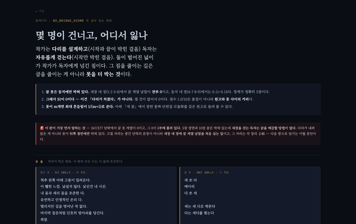](https://hyunjimoon.github.io/golden-cage-book/interactive/bridge_crossing.html) | **0.65 → 0.78.** 옛 칸이 못 하던 셋을 다 했다 — 못이 코드가 아니라 **저자가 박은 두 장면**이고(5장 「세 죽음」·10장 「다 죽음」), 한 다리가 아니라 **§ 넷으로 쪼개** 재고, 「몇 점」이 아니라 **몇 명이 건너나**를 뱉는다. 처방이 장+절까지 내려온다 — **1·2·3·4장 §結에 끝 계열 낱말을 처음 심어라.** 3초면 다시 잰다 |
| **3 장면인가 요약인가** 🧠 · **0.70** 「설명만 읽은 것 같아요」 [코드 열기](https://gist.github.com/hyunjimoon/48062b89743db6ed8cce570f7f79be13#file-03_-_-_-md) | [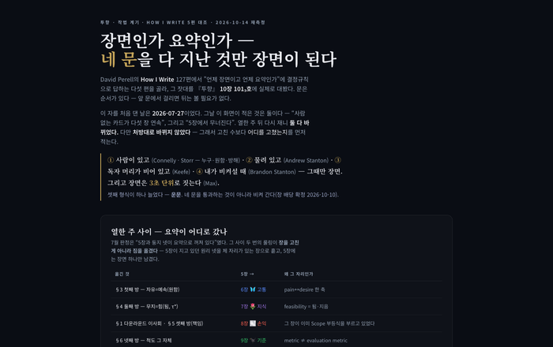](https://hyunjimoon.github.io/golden-cage-book/interactive/scene_or_summary.html) | **요약을 장면으로 내리라**는 가장 직접적인 문단 처방. 다만 코드가 없어 고친 뒤 다시 못 잰다 — 그만큼을 깎았다 |
| **1 야성미** 🧠 · **0.55** 「어디가 중요한지 모르겠어요」 [코드 열기](https://gist.github.com/hyunjimoon/48062b89743db6ed8cce570f7f79be13#file-01_yaseong_core-py) | [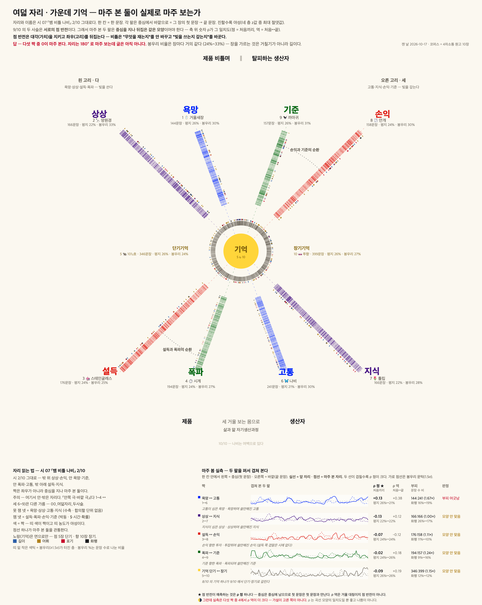](https://hyunjimoon.github.io/golden-cage-book/interactive/eight_seats.html) | 퇴고할 장의 **차례**를 정해 준다(장 안 4.9% ↔ 열 장 19.7%). 다만 **왜 튀는지는 모른다** — 문장을 직접 고쳐 주지 않는다 |
| **4 감정** 🫀 · **0.55** ⬇ 「인물이 왜 저러는지 안 와닿아요」 [코드 열기](./sbc_analyze.py) | [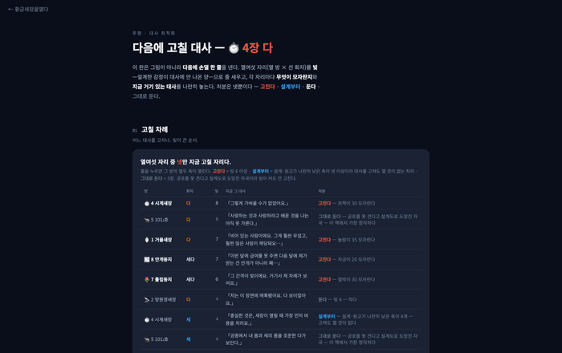](https://hyunjimoon.github.io/golden-cage-book/interactive/emotion.html) | **0.80 → 0.55** (위 🚨). 처방은 여전히 가장 세다 — **4장·8장을 고치고 5장은 둔다.** 내려간 건 처방이 아니라 **다시 잴 수단**이다. 셋 중 **생성기만 세우면 바로 1등으로 돌아온다** — 이 열에서 가장 싼 오르막 |

**동점 둘(야성미·감정)을 가른 것** — 야성미는 코드가 돌고 감정은 처방이 세다. 조건 ②(다시 잴 수 있나)를 ①(처방이 내려오나)보다 위에 뒀다. *고칠 자리를 아는 것보다 고친 뒤 확인할 수 있는 것이 4차 원고에선 더 비싸다* — 열 장을 두 번 돌려야 하기 때문이다.

### 빈 자리를 가리키는 **셋** — 고칠 문장이 아니라 **써야 할 자리**

| 칸 · 기관 · 기여확률 | 그림 | 왜 그 확률인가 |
|:--|:--:|:--|
| **6 세 층 지도** 👁️ · **0.52** 「이거 그냥 당신 얘기잖아요」 [코드 열기](https://gist.github.com/hyunjimoon/48062b89743db6ed8cce570f7f79be13#file-06_gen_graph_data-py) | [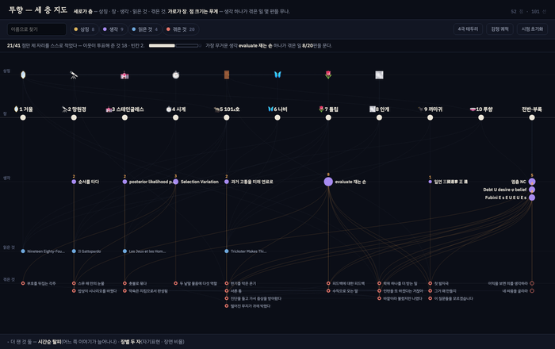](https://hyunjimoon.github.io/golden-cage-book/interactive/reference_graph.html) | **어느 장에 재료가 없나**를 가리킨다. 고칠 문장이 아니라 **써야 할 자리**를 준다. 2026-10-31 에 ⛺️덮개로 **296 → 53 노드**로 깎았다 — 화면이 처음으로 한눈에 들어온다 |
| **5 배선최적화** 🧠 · **0.45** 「자꾸 앞으로 되돌아가야 해요」 [코드 열기](https://gist.github.com/hyunjimoon/48062b89743db6ed8cce570f7f79be13#file-05_gen_product_atlas-py) · [덮개 코드](https://gist.github.com/hyunjimoon/48062b89743db6ed8cce570f7f79be13#file-05_baesun_mcmf-py) | [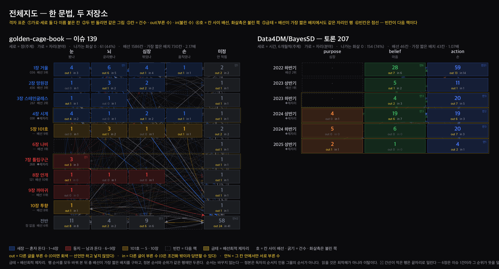](https://raw.githubusercontent.com/hyunjimoon/golden-cage-book/c95659b/img/grid_atlas.png) | **10장이 완전히 비어 있다**는 한 건이 크다. 그런데 장 차례는 안 바꾸고, 「어느 자리로 옮겨라」는 믿을 수 없다 — 기여가 그 한 건으로 수렴한다. 2026-10-31 에 ⛺️덮개가 이 칸에 붙어 **재료를 145→9 로 깎았는데 확률은 안 올렸다** — 깎인 것은 그래프이고 원고 문장은 그대로다 |
| **11 여덟의 다리** 👁️ · **0.35** 🆕 「이 책이 누구 얘긴지 모르겠어요」 [코드 열기](https://gist.github.com/hyunjimoon/48062b89743db6ed8cce570f7f79be13#file-11_gen_reader_bridges-py) | [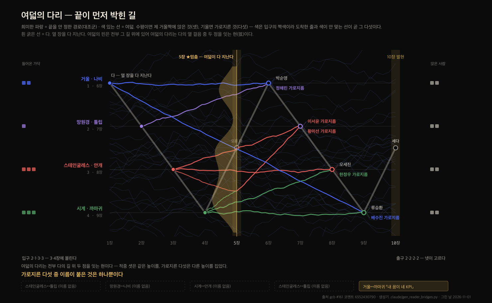](https://github.com/hyunjimoon/golden-cage-book/issues/161#issuecomment-6564869178) | **새 자 0개** — 스스로 그렇게 적었다. 있던 값을 **자리**로 옮겼을 뿐이라 원고 문장엔 안 닿는다. 그런데 ④가 유일하게 높다: 독자 여덟이 **밖이 앉을 자리**이고, 산출이 **음화 넷**(이름 없는 교차)이라 *쓸 자리*를 가리킨다. 모수 셋(출발·인내·민감도)은 아직 어림이고, `/reader` 투표가 오면 그 세 칸만 갈린다 |

### 이번 원고엔 안 닿는 넷 — 체계와 다음 책

| 칸 · 기관 · 기여확률 | 그림 | 왜 그 확률인가 |
|:--|:--:|:--|
| **7 주기율표** 👁️ · **0.35** 「빠진 게 있을 것 같은데 뭔지 모르겠어요」 [코드 열기](https://gist.github.com/hyunjimoon/48062b89743db6ed8cce570f7f79be13#file-07_gen_element_table-py) | [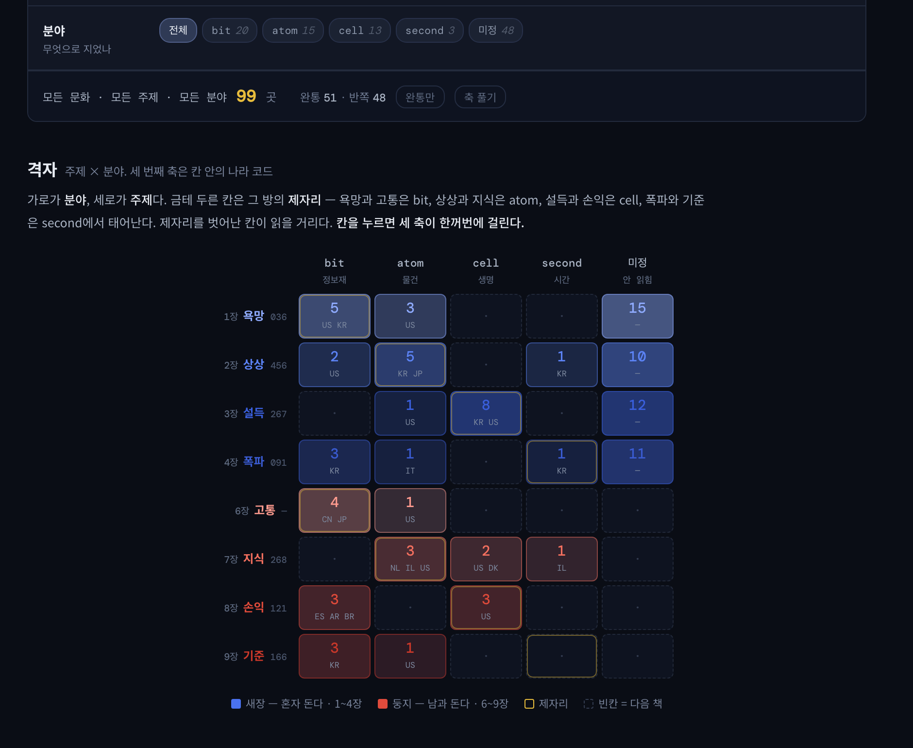](https://hyunjimoon.github.io/golden-cage-book/interactive/periodic_table_prototype.html) | **99곳 중 51**만 세 축이 읽혔다. 그런데 자장님이 직접 적었다 — **빈칸이 다음 책이다.** 이번 원고의 몫이 아니다 |
| **10 두 무늬 겹침** 👁️ · **0.30** 「당신 글이랑 이 책이랑 따로 노는데요」 [코드 열기](https://gist.github.com/hyunjimoon/48062b89743db6ed8cce570f7f79be13#file-10_style_converge-py) | [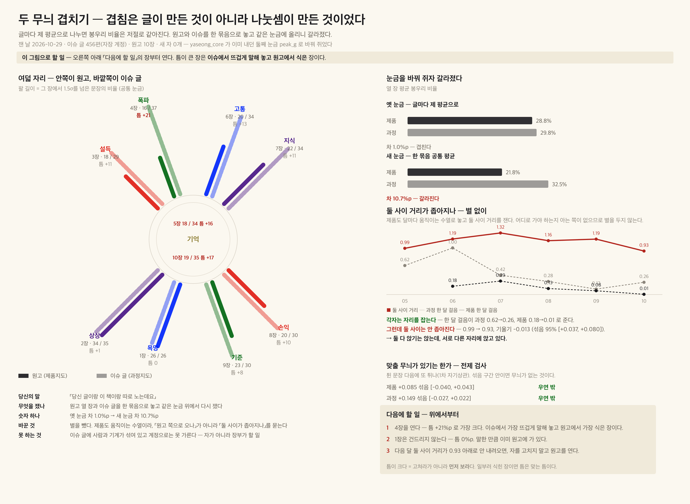](https://raw.githubusercontent.com/hyunjimoon/golden-cage-book/6955edd/img/style_converge.png) | 둘 사이 **1.26 → 0.89**. 아직 「그래서 어느 문장을 고치라」가 안 나온다. 과녁이 아직 **나 자신**이고, 읽는 이의 글로 돌리면 올라간다 |
| **8 팔림과 됨** 🫀 · **0.25** 「그래서 이 책은 됐나요」 [코드 열기](./08_sell_and_become_nocode.md) | [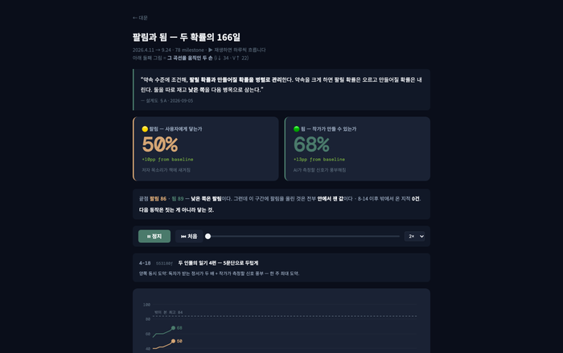](https://hyunjimoon.github.io/golden-cage-book/interactive/probability_evolution.html) | 원고 문장을 바꾸지 않는다. **밖에서 온 지적 0건**이 이 자의 실측이자 이 책의 가장 급한 구멍 — 급한 것과 원고에 닿는 것은 다르다 |
| **9 살찌는뱀** 🤚 · **0.20** 「그래서 당신은 변했나요」 [코드 열기](https://gist.github.com/hyunjimoon/48062b89743db6ed8cce570f7f79be13#file-09_molt_map-py) | [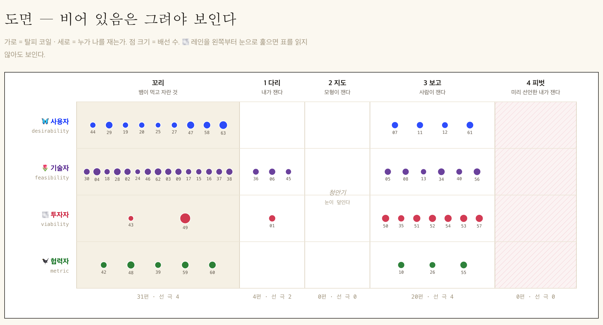](https://raw.githubusercontent.com/hyunjimoon/golden-cage-book/c95659b/img/shot_molt_map.png) | 허물 넷에 62편. **두 번째가 0편**인 건 기록의 구멍이지 원고의 구멍이 아니다 |
| **이 목록을 센 자** 눈 17 · 뇌 9 · 심장 15 · **손 0** [코드 열기](https://gist.github.com/hyunjimoon/48062b89743db6ed8cce570f7f79be13#file-10_organ_census-py) | — | 그림이 없는 유일한 칸. 세기만 하고 그리지 않는다 |

**기관 넷은 「이 자가 무엇을 하나」가 아니라 「누구의 비용을 줄이나」로 달았다** — 👁️ 읽는 이의 배경과 틈을 본다 · 🧠 읽는 이의 시간을 아낀다 · 🫀 쓰는 이와 읽는 이의 고리가 돈다 · 🤚 내보낸 글이 왜 안 닿았나. **뇌 4 · 눈 3 · 심장 2 · 손 1** — vault 실측(눈 17 · 뇌 9 · 심장 15 · 손 0)과 거의 뒤집혀 있다. 자를 만들 때는 독자의 시간을 궁리했고, vault에 쌓인 것은 본 것이다.

---

읽는 법 — 각 칸은 **그림 하나 + 다섯 줄**이다. 다섯 줄은 **당신의 말 · 그래서 무엇을 쟀나 · 숫자 하나 · 그 숫자가 원고를 어떻게 바꿨나 · 이 자가 못 하는 것.**
다섯째 줄을 반드시 남긴 이유: 못 하는 걸 안 적은 자는 자가 아니라 장식이다.
**그림을 누르면 살아 있는 화면**으로, **파일 이름을 누르면 이 폴더 안의 그 코드**로 간다. 파일 맨 위 넉 줄은 **찍힌 띠**다 — 번호 · 독자의 물음 · 원본 주소. 입력·출력·실측·돌리는 법은 그 아래 원본 머리말과 이 글이 진다.
열 중 둘(3·8)은 **코드가 없다.** 없는 채로 칸을 뒀다 — 빈칸은 산출물이다.

---

## 읽는 동안

### 1. 「어디가 중요한지 모르겠어요」

문장이 고르면 눈이 쉴 데가 없다. 네 가지로 **어느 문장이 튀는지** 쟀다 — 길이 · 드문 낱말 · 한자와 숫자가 섞이는 자리 · 묻고 외치는 말투.
숫자 — 한 장 안에서만 재면 문장 들쭉날쭉함이 **4.9%**, 열 장을 통째로 놓고 재면 **19.7%**. 네 배다.
바꾼 것 — 그래서 자를 두 벌 쓴다. 한 벌만 쓰면 장 **안의** 리듬이나 장 **사이의** 온도 중 하나를 통째로 못 본다.
못 하는 것 — 왜 튀는지는 모른다. 튄 자리만 가리킨다.
*🧠 야성미 · [`01_yaseong_core.py`](https://gist.github.com/hyunjimoon/48062b89743db6ed8cce570f7f79be13#file-01_yaseong_core-py) · [여덟 좌석 열기](https://hyunjimoon.github.io/golden-cage-book/interactive/eight_seats.html)*

### 2. 「시작은 좋았는데 중간에 길을 잃었어요」

[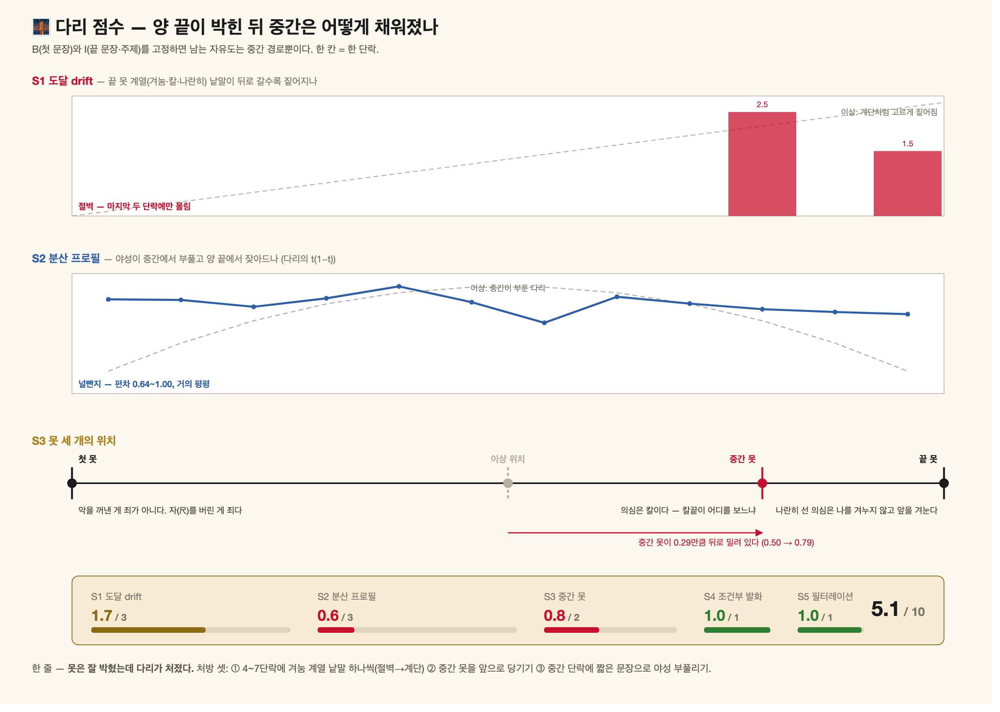](https://raw.githubusercontent.com/hyunjimoon/golden-cage-book/c95659b/img/shot_bridge_score.png)

첫 문장과 끝 문장이 못처럼 박혔을 때, 그 사이가 **다리답게 걸렸는지** 쟀다. 강에 놓은 다리는 가운데가 가장 많이 흔들리고 양 끝이 잠잠하다. 글도 그래야 한다.
숫자 — 에세이 한 편에 돌린 결과 **5.1점 / 10점.** 중간 못이 한가운데(0.50)가 아니라 **0.79**에 가 있고, 가운데가 부풀어야 할 분산이 **0.6 / 3**이다.
바꾼 것 — **못은 잘 박혔는데 다리가 처졌다**는 진단이 나왔다. 처방 셋 — 중간 단락에 짧은 문장을 넣어 부풀리기 · 중간 못을 앞으로 당기기 · 뒤로 갈수록 끝 낱말을 짙게.
못 하는 것 — 못으로 쓸 낱말이 코드에 박혀 있어 다른 글엔 그대로 못 쓴다.
*🧠 갈색다리 · [`02_bridge_score.py`](https://gist.github.com/hyunjimoon/48062b89743db6ed8cce570f7f79be13#file-02_bridge_score-py)*

### 3. 「설명만 읽은 것 같아요」

장면인가 요약인가. 문 넷을 세웠다 — 사람이 있나 · 서로 물리나 · 머릿속 여백이 남나 · 누구 눈으로 보나. **넷을 다 지난 것만 장면이다.**
숫자 — 9장까지 평평하다가 **10장에서 튄다.**
바꾼 것 — 튀는 자리를 고치지 않고 **남겼다.** 마지막 장이 장면으로 돌아서는 것이 이 책의 끝이다.
못 하는 것 — 판정이 손으로 적혀 있어 다시 못 돌린다. 🎟️ 자는 있고 코드가 없는 자리.
*🧠 장면인가 요약인가 · [`03_scene_or_summary_nocode.md`](https://gist.github.com/hyunjimoon/48062b89743db6ed8cce570f7f79be13#file-03_-_-_-md) · [화면 열기](https://hyunjimoon.github.io/golden-cage-book/interactive/scene_or_summary.html)*

### 4. 「인물이 왜 저러는지 안 와닿아요」

열 장 × 말하는 이 셋(다 · 세 · 세다)의 감정을 열여섯 축으로 쟀다. 같은 장을 **두 자리에서** 잰다 — 한복판에서 한 말과, 뒤쪽 장이 되돌아보며 한 말.
숫자 — 고칠 곳은 **4장과 8장**(합계 12와 10).
바꾼 것 — 빚이 가장 큰 **5장은 안 고쳤다.** 공포를 못 견디고 설계도로 도망친 자국이라, 그 자리는 틀린 게 아니라 정직한 것이다.
못 하는 것 — 한복판만 재면 무뎌진 감정을 「감정이 없다」로 오해한다. 5장이 바로 그 함정이었다(무감 55인데 그 옆에 분노 28).
*🫀 감정 · [`sbc_analyze.py`](./sbc_analyze.py) · [화면 열기](https://hyunjimoon.github.io/golden-cage-book/interactive/emotion.html)*

### 5. 「자꾸 앞으로 되돌아가야 해요」

11장에서 3장을 다시 부르면 당신은 여덟 장을 거슬러 올라가거나, 포기하고 모르는 채 읽는다. 그 **되돌아가는 거리의 총합**을 쟀다.
내용은 한 글자도 안 고치고 **순서만** 바꿨을 때 거리가 얼마나 주는가 — 교실에서 쪽지 주고받는 아이들을 자리만 바꿔 앉히는 일과 같다.
숫자 — 제품지도는 지금 순서가 가장 짧은 배치의 **1.38배**(열 장 기준). 위 그림의 과정지도는 **2.17배**. 당신은 꼭 필요한 것보다 그만큼을 걷고 있다.
바꾼 것 — 아직 안 바꿨다. 다만 **10장이 완전히 비어 있다**는 게 여기서 드러났다. 그림의 **금테 = 순서를 다시 짜도 제자리에 남는 행**이다.
못 하는 것 — 「총 거리」는 믿어도 되지만 **「어느 자리로 옮겨라」는 믿으면 안 된다.** 아주 다른 순서 셋이 1.000 · 1.001 · 1.033배로 거의 같은 거리를 낸다. 짧은 게 늘 좋은 것도 아니다 — 1장에 놓고 10장에서 갚는 복선은 **일부러 긴** 선이다.
*🧠 배선최적화 · [`05_gen_product_atlas.py`](https://gist.github.com/hyunjimoon/48062b89743db6ed8cce570f7f79be13#file-05_gen_product_atlas-py)(돌리는 쪽) · [`05_minla_gen_grid_atlas.py`](https://gist.github.com/hyunjimoon/48062b89743db6ed8cce570f7f79be13#file-05_minla_gen_grid_atlas-py)(자가 든 쪽, 44줄 `minla()`)*
*⚠️ 「배선최적화」라는 한 이름을 두 알고리즘이 쓴다 — 지면 **차례**를 정하는 최소 총배선과, 일화를 **장에 앉히는** 최소비용 최대흐름이다. 전에 이 줄은 「최소비용 최대흐름 쪽은 비유로만 남긴다」고 적었는데 **그 줄이 틀렸다** — 코드가 있고 돌아간다. 2026-10-31 에 올렸다: [`05_baesun_mcmf.py`](https://gist.github.com/hyunjimoon/48062b89743db6ed8cce570f7f79be13#file-05_baesun_mcmf-py).*

**같은 칸에 하나 더 — ⛺️ 지식덮개** (2026-10-31. 칸은 안 늘렸다, 재료가 같아서다)

덮개는 차례를 묻지 않고 **무엇을 버리나**를 묻는다. 왼쪽에 불(아픈 일)을 적고 오른쪽에 의지가 되는 생각을 적고 둘 사이에 선을 긋는다. 그다음 선이 가장 많이 달린 생각부터 집고, 그 생각이 닿은 불을 지운다. 불이 남았으면 다시 집는다. 수식이 없다.
순서가 자다 — **배선이 먼저** 일화 65편 중 자리 20개를 가르고, **덮개는 그 20편만** 덮는다. 65 전체를 덮으면 지면에 안 올 일화를 받치는 생각이 살아남는다.
숫자 — 자리를 받은 일화 **20편**을 생각원소 **9편**이 전부 덮는다(145 중 9 · **−94%**). 선은 444 → **41**(−91%). 동점 순서를 400번 흔들어도 크기는 9에서 안 변했다.
바꾼 것 — 아직 안 지웠다. 드러난 것은 **덮개 1등 하나(`재는 손`)가 20편 중 8편을 문다**는 것이다. 열 장 전부 일화와 덮개를 쥐었다.
못 하는 것 — 덮개는 **중요한 것이 아니라 자주 불린 것**을 고른다. 그리고 📜읽은 것 55편은 이 자로 **0**이 되는데, 그쪽은 일화가 부르는 게 아니라 **장에 붙기** 때문이다 — 0은 발견이 아니라 자가 틀린 신호다. 무엇보다, 셈에 맡기면 사례 장부 0건인 「지른 나, 막는 나」가 지워져 **5장·10장이 통째로 날아간다.** 그래서 한 질문이 셈보다 위에 선다 — **남에게 안 일어나는 건가, 남이 안 적는 건가?**
*🧠 지식덮개 · [`05_baesun_mcmf.py`](https://gist.github.com/hyunjimoon/48062b89743db6ed8cce570f7f79be13#file-05_baesun_mcmf-py) · `python3 .claude/baesun_mcmf.py --cover`*

---

## 책을 덮으며

### 6. 「이거 그냥 당신 얘기잖아요」

이 책의 재료는 둘이다 — **읽은 것**(남의 몸을 거친 것)과 **겪은 것**(내 몸을 거친 것). 둘이 실제로 이어져 생각을 낳았는지를 선으로 그렸다.
숫자 — 깎기 전 노드 296개 · 선 865개. **깎은 뒤 53개 · 111개**(−82% · −87%).
남긴 것 넷 — 자리 받은 일화 **20** · 그 20편을 전부 덮는 생각원소 **9** · 열 장을 전부 덮는 읽은 것 **4** · 상징 **8**.
바꾼 것 — 선은 낱말이 **정확히 일치**할 때만 긋는다. 비슷해 보인다고 이으면 그 선이 곧 거짓말이 되기 때문이다.
못 하는 것 — 읽은 것은 제 자리를 스스로 신고하는데(55 중 49) 겪은 것은 못 한다. 겪은 일이 몇 장짜리인지는 나중에야 정해지니까. 그래서 겪은 것의 자리는 **이웃이 투표해서** 정한다.
깎은 자 — 칸 5 의 ⛺️덮개와 💣배선이다([`05_baesun_mcmf.py`](https://gist.github.com/hyunjimoon/48062b89743db6ed8cce570f7f79be13#file-05_baesun_mcmf-py)). 자를 새로 만들지 않았다.
*👁️ 세 층 지도 · [`06_gen_graph_data.py`](https://gist.github.com/hyunjimoon/48062b89743db6ed8cce570f7f79be13#file-06_gen_graph_data-py) · `PRUNE=1 python3 gen_graph_data.py` (PRUNE=0 이면 전부) · [화면 열기](https://hyunjimoon.github.io/golden-cage-book/interactive/reference_graph.html)*

### 7. 「빠진 게 있을 것 같은데 뭔지 모르겠어요」

멘델레예프는 원소를 표에 앉히다가 **빈칸을 보고** 아직 발견 안 된 원소를 예언했다. 이 책의 생각들도 같은 표에 앉혔다. 쓸모는 채워진 칸이 아니라 **빈칸**이다.
숫자 — 낱눈 **99**곳 중 세 축이 다 읽힌 것 **51**, 한쪽만 읽힌 것 **48**.
바꾼 것 — 빈칸을 손으로 적어 넣던 것을 그만두고 **자동으로 계산하게** 했다. 손으로 적으면 보고 싶은 빈칸만 보인다.
못 하는 것 — 넓이를 얻고 해상도를 잃는다. **반쪽 48이 그 대가다.** 한쪽만 적힌 칸은 반쪽이 아니라 빈칸이다.
*👁️ 주기율표 · [`07_gen_element_table.py`](https://gist.github.com/hyunjimoon/48062b89743db6ed8cce570f7f79be13#file-07_gen_element_table-py) · [화면 열기](https://hyunjimoon.github.io/golden-cage-book/interactive/periodic_table_prototype.html)*

---

## 책을 덮은 뒤

### 8. 「그래서 이 책은 됐나요」

창업에는 두 확률이 있다 — **팔릴 확률**과 **만들어질 확률**. 둘은 따로 놀지 않는다. 크게 약속하면 팔릴 확률이 오르고 만들 확률이 내린다. 그 둘을 약속 수준 위에서 곱해 더했다.
숫자 — 166일 · 78개 사건 · 끝점에서 **팔림 86 · 됨 89**. 병목은 **팔림**이다.
바꾼 것 — 아직 못 바꿨다.
못 하는 것 — **이 값은 전부 안에서 잰 것이고, 밖에서 온 지적은 0건이다.** 게다가 숫자가 화면에 손으로 박혀 있어 밖의 값이 와도 넣을 자리가 없다. 🎟️ 열 중 가장 급한 구멍.
*🫀 팔림과 됨 · [`08_sell_and_become_nocode.md`](./08_sell_and_become_nocode.md) · [화면 열기](https://hyunjimoon.github.io/golden-cage-book/interactive/probability_evolution.html)*

### 9. 「그래서 당신은 변했나요」

책이 바뀌었는지가 아니라 **쓴 사람이 바뀌었는지**를 묻는 자리. 1.5개월 → 3개월 → 4개월 → 4개월, 네 번 허물을 벗었고 **앞선 허물의 아픔을 다음 허물의 연료로** 썼다. 가로가 허물, 세로가 **누가 나를 재는가**다.
숫자 — 겪은 일 **62편.** 허물 넷에 **31 · 4 · 0 · 20 · 0**편이 걸려 있다.
바꾼 것 — **두 번째 허물이 0편이다.** 벗은 건 아는데 기록이 없다. 안 벗은 네 번째가 0인 건 맞는 0이고(탈피는 끝난 뒤에만 세어진다), 두 번째의 0은 **구멍**이다. 둘을 같은 0으로 적지 않으려고 코일을 「닫혔나」로 갈랐다.
못 하는 것 — 쓴 사람이 **얼마나** 변했는지는 못 잰다. 몇 번 벗었고 그때 누가 자를 쥐고 있었는지만 센다. 그리고 날짜가 없는 7편은 월을 지어내지 않고 도면 밖에 뒀다 — **도면에서 빠진 것이지 장부에서 빠진 것이 아니다.**
*🤚 살찌는뱀 · [`09_molt_map.py`](https://gist.github.com/hyunjimoon/48062b89743db6ed8cce570f7f79be13#file-09_molt_map-py)*

### 10. 「당신 글이랑 이 책이랑 따로 노는데요」

책은 원고가 쓰고, 그 책을 만드는 동안 나는 깃허브에 따로 글을 썼다. **둘이 같은 손에서 나왔는지**를 두 지도로 겹쳐 봤다.
숫자 — 옛 눈금에서 두 판은 **28.7% 대 31.0%**로 겹쳤다(차 2.3%p). 같은 눈금에 올리니 **23.0% 대 33.0%**로 갈라졌다(차 10.0%p).
바꾼 것 — 세 번 거뒀다. **「두 판이 닮았다」** — 겹침은 글이 아니라 **나눗셈**에서 왔다. **별** — 제품도 달마다 자라므로 git에서 꺼내 수열로 놓고 둘 **사이** 거리를 쟀다(#139 코시). 그리고 **빠진 자료** — 받아둔 캐시에 `author` 칸이 없어 **이슈 본문 143건이 통째로 빠진 채** 코멘트만 세어지고 있었다(5,731 → 8,675문장). 다시 재니 각자의 한 달 걸음이 준다(과정 0.72→0.25 · 제품 0.17→0.01)**그리고 둘 사이도 1.26 → 0.89로 좁아진다**(기울기 −0.056, 섞음 95% [+0.043, +0.074] 밖). 아직 0.89 만큼 떨어져 있다.
못 하는 것 — 이슈 글에 사람과 기계가 **섞여 있는데 계정으로는 못 가른다**(488 코멘트가 사실상 한 계정). 공통 눈금도 중립이 아니다 — 묶음에 제품이 여섯 번 들어가 눈금을 제품 쪽으로 끈다. 제품 수열은 05~10월 여섯 점뿐이라 기울기가 약하다. 그리고 「가까워졌다」가 「좋아졌다」는 아니다.
*👁️ 두 무늬 겹침 · [`10_style_converge.py`](https://gist.github.com/hyunjimoon/48062b89743db6ed8cce570f7f79be13#file-10_style_converge-py)*

---

### 11. 「이 책이 누구 얘긴지 모르겠어요」

독자 여덟이 **어느 새장으로 들어와 어느 이해관계자로 나가나**를 그렸다. 양 끝이 박힌 걸음이라 다리(브라운 다리)이고, 끝을 안 정한 걸음(희미한 파랑)이 대조군이다.
`/reader` [#161](https://github.com/hyunjimoon/golden-cage-book/issues/161) 투표로 **둘 다 남겼다** — 뒤가 앞의 개정판이 아니라 **아홉 번째 다리**라서다.

 

*왼쪽 — 모형과 경고. 오른쪽 — 다의 길을 그어 여덟이 그 길 위 두 점을 잇는 **현(弦)**임을 보인 판.*

숫자 — **입구 2·1·3·3, 출구 2·2·2·2.** 들어오는 자리는 3·4장에 몰리는데 나가는 자리는 넷에 고르게 갈린다.
바꾼 것 — 아직 원고를 안 바꿨다. 대신 **이름 없는 칸 넷**이 나왔다. 가로지른 다섯 중 이름이 붙은 교차는 하나뿐이다(🪞↔🐦‍⬛ 「내 꿈이 네 KPI」).
못 하는 것 — **새 자가 0개다.** 있던 값을 자리로 옮겼을 뿐이고, 가운데 흔들림은 보간이라 **값으로 읽으면 안 된다.** 독자 넷의 출발·인내·민감도는 어림이다.
*👁️ 여덟의 다리 · [`11_gen_reader_bridges.py`](https://gist.github.com/hyunjimoon/48062b89743db6ed8cce570f7f79be13#file-11_gen_reader_bridges-py) · [#161 코멘트](https://github.com/hyunjimoon/golden-cage-book/issues/161#issuecomment-6564869178)*

> **🌗 음화 — 이 판이 아직 못 그린 것 셋** *(2026-11-02, [#158 정한 결론](https://github.com/hyunjimoon/golden-cage-book/issues/158#issuecomment-6457024097)과 맞춰 봄)*
> #158 은 항로를 **개인 → 사회 → 개인**으로, 끝을 **시간평균과 공간평균의 순서를 바꿔도 같다**로 적었다. 이 판은 축을 이미 맞게 놓았다 — 가로가 장(시간), 세로가 거울짝(공간). 그런데
> ⑴ **세의 길이 없다.** 10장 노드는 「세다」인데 도착하는 세의 선이 없다. 끝이 둘인데 무차별인 것이 결론인데, 선이 하나면 옆에 둬도 **다가 모범**이다
> ⑵ **평균 연산 둘이 없다.** 접는 화살표 → 와 ↓ 가 그림에 없다. 경로만 있고 평균이 없다
> ⑶ **다리는 끝을 하나 박는다.** 결론이 요구하는 건 **두 끝 위의 혼합** — de Finetti 표현이지 브라운 다리가 아니다
> 다만 **음화 넷은 고치지 않는다.** 이름 붙은 하나 · 이름 없는 넷이 곧 *부분*교환가능성의 그림이다 — 어떤 교환은 이미 허용됐고 넷은 아직 안 갈렸다.

---

## 이 목록을 센 자

위 열을 👁️ 눈 · 🧠 뇌 · 🫀 심장 · 🤚 손으로 갈랐다. 그 넷이 vault 안에서 각각 몇인지 세는 자가 따로 있다.
실측 — **눈 17 · 뇌 9 · 심장 15 · 손 0.**
**손이 0이다.** 본 것도 궁리한 것도 뛴 것도 쌓였는데 밖으로 나간 것이 없다. 8번의 「밖에서 온 지적 0건」과 같은 구멍이고, 지금 이 글이 그 구멍을 메우려는 첫 시도다.
그림이 없는 유일한 칸이다. 이 자는 세기만 하고 그리지 않는다.
*[`10_organ_census.py`](https://gist.github.com/hyunjimoon/48062b89743db6ed8cce570f7f79be13#file-10_organ_census-py)*

---

## 쓰는 사람을 위한 각주

- 생성물을 손으로 고치지 마라. 생성기를 고쳐라. 위 그림은 전부 아래 코드가 뱉은 것이다.
- **빈칸은 산출물이다.** 기대를 실제인 척 적는 것이 가장 비싼 거짓 기재다.
- 자를 고칠 때마다 양쪽을 함께 본다. 한쪽만 보면 반대쪽으로 넘어가는 진자가 된다.
- **「없음」은 발견이 아니라 자를 의심할 신호다.**

