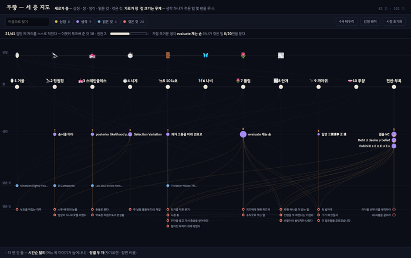
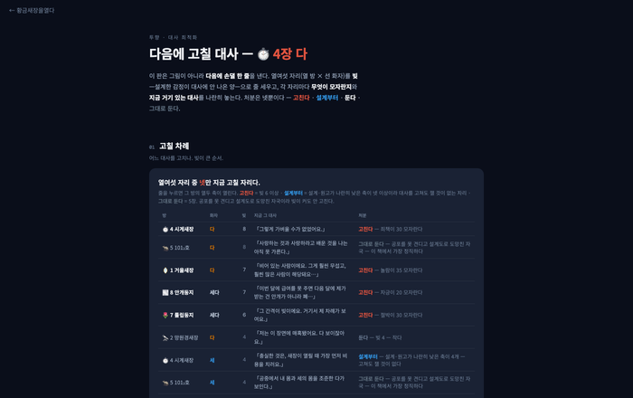
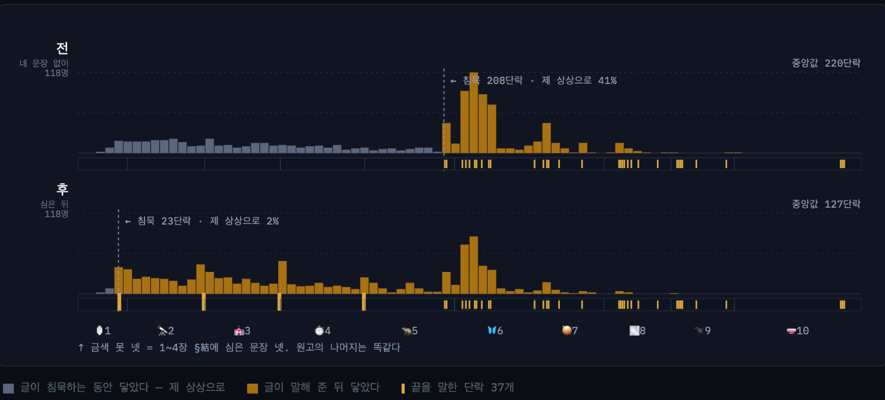

# `scripts/` — 「투향」을 재는 다섯

> **이 다섯은 한 바퀴 셋 + 파생 셋으로 묶인다** (2026-[[11-18]]) — 🔵**걷기** `04_bridge_crossing` · 🟣**덮기** `jisik_cover`+`01_baesun_mcmf` · 🟢**재기** `03_sbc_analyze`. 파생 셋은 `02_graph_data` · `molt_map` · 🟡**문체수렴** `05_style_converge`(+`yaseong_core`).

> **`05_style_converge.py` — 쓴 글과 짓는 글이 가까워졌나** (2026-[[11-18]] 올림). 소설 열 장과, 그 소설을 짓는 동안 저자 계정으로 쓴 이슈·코멘트를 **한 자루에 넣어 같은 눈금으로** 잰다. 달마다 두 점을 찍고 그 사이 거리를 본다.
> `MAP_CACHE= python3 scripts/05_style_converge.py` — `gh` 로그인만 있으면 **밖에서 그대로 돌아간다.** 자가 저자 컴퓨터 안에만 있던 마지막 하나였다.
> ⚠️ **이 사본의 값은 저자 판과 조금 다르다.** 입력이 vault 원본이 아니라 **공개면 `chapters/`** 이고, 월말 원고도 **이 저장소 역사**에서 꺼내기 때문이다. 실측 비교 — 봉우리% 저자 26.7·30.9 / 여기 **26.8·30.9**, 자기상관 +0.123·+0.147 / 여기 **+0.124·+0.147**, 기울기 −0.0679 / 여기 **−0.0556**(섞음 95% [+0.0252,+0.0405] **밖**).
> 🌗 **결론은 둘 다 같다** — 거리가 줄고, 섞음 구간의 반대편에 선다. **다른 자료로 같은 답이 나온 것**이라 저자 판 하나보다 세다.
> 한 장으로 → [#166 걷기·덮기·재기](https://github.com/hyunjimoon/golden-cage-book/issues/166#issuecomment-6869199941) · 짓는 과정과 슬라이드 → [#177 세 기술](https://github.com/hyunjimoon/golden-cage-book/issues/177#issuecomment-6945220825)
> 아래 번호(01\~04)는 **파일 주소라 안 바꾼다.** 묶음이 바뀌어도 이름은 그대로다.

소설 한 권에 코드가 붙어 있는 이유는 하나다. 「투향」은 **검증하지 않은 낭만이 어떻게 새장이 되는지**에 대한 책이고, 그러면 이 책 자신도 검증을 받아야 한다.

그런데 자를 열넷까지 늘려 놓고 보니 **밖에서 온 지적이 0건이었다.** 자가 모자라서가 아니라 밖이 돌려 볼 수 없어서다. 그래서 2026-11-15 에 열넷을 **넷**으로 끊었다. 내린 열은 아래 「내린 열」에 한 줄씩 있고, 코드는 저자 vault 에 그대로 산다 — 지운 게 아니라 **내린 것**이다.

> **이 폴더는 코드와 그림이 함께 있다.** `01_x.py` 의 그림은 `01_x.png` 다. 번호 없는 `.py` 는 자가 아니라 **의존**이고 그림이 없다. 짝이 없으면 생성기가 「그림 없는 자」로 보고한다 — 빈칸은 숨기지 않는다.

---

## 왜 이 넷인가

끊은 자는 「원고를 고칠 확률」이 아니다. [#166 마무리 현황판](https://github.com/hyunjimoon/golden-cage-book/issues/166)이 **주춧돌 셋**을 적어 놓았다 — 경험·지식·사례, *「책을 다시 세워야 한다면 이 셋만 있으면 된다」*. 거기에 [11-09 STRAP 진단](https://github.com/hyunjimoon/golden-cage-book/issues/166#issuecomment-6740862530)이 병목을 **손**으로 찍었다. 둘을 겹치면 자가 답해야 할 물음이 하나로 모인다.

> **밖의 한 사람이 주춧돌 셋을 제 손으로 다시 셀 수 있는가.**

| 주춧돌 | #166 이 센 수 | 값을 쥔 자 |
|:--|--:|:--|
| 경험 — 겪은 것, 장마다 둘 | **19** | [`01_baesun_mcmf.py`](./01_baesun_mcmf.py) |
| 지식 — 궁리한 것, 거울짝마다 하나 | **8** | [`jisik_cover.py`](./jisik_cover.py) *(01 이 부른다)* |
| 사례 — 남의 창업, §3 있는 장마다 둘 | **16** | 원고 각 장 §3 — **코드가 없다** |

셋을 한 그림에 겹쳐 *정말 이어졌는지* 보는 자가 [`02_graph_data.py`](./02_graph_data.py)이고, 인물 셋(다·세·세다)의 감정을 재는 [`03_sbc_analyze.py`](./03_sbc_analyze.py)는 **밖에서 실제로 도는 유일한 자**다. [`04_bridge_crossing.py`](./04_bridge_crossing.py)는 지금 가장 크게 열려 있는 [#168 모서리 열](https://github.com/hyunjimoon/golden-cage-book/issues/168)(5/10)과 같은 자리 — 각 장 §結 — 를 잰다.

---

## 재현은 코드가 아니라 입력이 가른다

열둘이 gist 에 묶여 있던 것을 「옮기면 재현된다」고 적었는데, **틀렸다.** 다 옮겨도 재현되는 수는 안 움직인다. 가르는 것은 코드가 어디 있느냐가 아니라 **입력이 공개면에 있느냐**다.

| 자 | 코드 | 입력 | 밖이 돌리나 |
|:--|:--|:--|:--:|
| 01 배선 · 지식덮개 | 이 폴더 | 저자 vault 절대경로 | ✗ |
| 02 세 층 지도 | 이 폴더 | 저자 vault 절대경로 | ✗ |
| 03 감정 | 이 폴더 | `chapters/ch*.md` — 공개 | **✓** |
| 04 갈색다리 | 이 폴더 | `chapters/` — 공개 | **✓** |

**지금 둘.** 01·02 는 코드를 읽을 수는 있으나 돌릴 수는 없다.

다만 **그 둘의 산출은 이미 공개면에 통째로 있다.** `interactive/reference_graph.html` 의 `const DATA` 를 세면 노드 51 · 선 104 이고, 그 안에 경험 **19** · 지식 **8** 이 그대로 앉아 있다 — #166 표1·표2 와 같은 수다. 산출이 공개인데 입력이 비공개라, 밖은 **값을 볼 수는 있고 다시 셀 수는 없다.** 이 틈을 메우는 길은 입력을 공개 fixture 로 얼리는 것 하나인데, 일화 frontmatter 에 사람 이름과 메일 증거가 들어 있어 그대로는 못 낸다. 아래 「음화」의 ①이다.

---

## 넷

### 01 · 「자꾸 앞으로 되돌아가야 해요」 — 배선과 지식덮개

11장에서 3장을 다시 부르면 당신은 여덟 장을 거슬러 올라가거나, 포기하고 모르는 채 읽는다. 그 **되돌아가는 거리의 총합**을 쟀다. 내용은 한 글자도 안 고치고 순서만 바꿨을 때 거리가 얼마나 주는가 — 교실에서 쪽지 주고받는 아이들을 자리만 바꿔 앉히는 일과 같다.

같은 재료로 **덮개**가 묻는 것은 다르다. 차례가 아니라 **무엇을 버리나**다. 왼쪽에 불(아픈 일)을 적고 오른쪽에 의지가 되는 생각을 적고 둘 사이에 선을 긋는다. 선이 가장 많이 달린 생각부터 집고, 그 생각이 닿은 불을 지운다. 불이 남았으면 다시 집는다. 수식이 없다.

순서가 자다 — **배선이 먼저** 일화 65편 중 자리 20개를 가르고, **덮개는 그 20편만** 덮는다. 65 전체를 덮으면 지면에 안 올 일화를 받치는 생각이 살아남는다.

- **숫자** — 제품지도는 지금 순서가 가장 짧은 배치의 **1.38배**. 자리를 받은 일화 **19편**을 생각원소 **8편**이 전부 덮는다(145 중 8). 선은 444 → **41**.
- **바꾼 것** — 아직 안 지웠다. 드러난 것은 덮개 1등 하나(`g5_13_evaluate_재는_손`)가 네 장(2·6·8·9)을 혼자 문다는 것이다. #166 음화 ④가 그 단일 실패점이다.
- **못 하는 것** — 「총 거리」는 믿어도 되지만 **「어느 자리로 옮겨라」는 믿으면 안 된다.** 아주 다른 순서 셋이 1.000 · 1.001 · 1.033배로 거의 같은 거리를 낸다. 그리고 덮개는 **중요한 것이 아니라 자주 불린 것**을 고른다. 셈에 맡기면 사례 장부 0건인 「지른 나, 막는 나」가 지워져 5장·10장이 통째로 날아간다. 그래서 한 질문이 셈보다 위에 선다 — **남에게 안 일어나는 건가, 남이 안 적는 건가?**
- **그림이 없다.** `--html` 이 자리 경합 한 장을 뱉는데 저자 vault 안에만 떨어진다. 짝 규칙이 이 빈칸을 매번 보고한다.

```
python3 01_baesun_mcmf.py            # 계산만 하고 보고
python3 01_baesun_mcmf.py --cover    # 덮개
python3 01_baesun_mcmf.py --whatif ep35:g5_07   # 지우기 전에 무엇이 대신 앉나
```

> 값을 손으로 고치지 않는다. 되돌리려면 `01_baesun_mcmf.py` 의 `PIN` 에 그 장·그 원소를 적는다 — **룰링은 솔버를 이긴다.**

### 02 · 「이거 그냥 당신 얘기잖아요」 — 세 층 지도

[](https://hyunjimoon.github.io/golden-cage-book/interactive/reference_graph.html)

이 책의 재료는 둘이다 — **읽은 것**(남의 몸을 거친 것)과 **겪은 것**(내 몸을 거친 것). 둘이 실제로 이어져 생각을 낳았는지를 선으로 그렸다.

- **숫자** — 깎기 전 노드 296 · 선 865. 지금 **51 · 104**. 남긴 것 넷 — 자리 받은 일화 **19** · 그 19편을 전부 덮는 생각원소 **8** · 열 장을 전부 덮는 읽은 것 **4** · 상징 **8**.
- **바꾼 것** — 선은 낱말이 **정확히 일치**할 때만 긋는다. 비슷해 보인다고 이으면 그 선이 곧 거짓말이 된다.
- **못 하는 것** — 읽은 것은 제 자리를 스스로 신고하는데 겪은 것은 못 한다. 겪은 일이 몇 장짜리인지는 나중에야 정해지니까. 그래서 겪은 것의 자리는 **이웃이 투표해서** 정한다.
- 깎은 자는 01 이다. 자를 새로 만들지 않았다.

```
PRUNE=1 python3 02_graph_data.py     # PRUNE=0 이면 전부 그린다
```

### 03 · 「인물이 왜 저러는지 안 와닿아요」 — 감정

[](https://hyunjimoon.github.io/golden-cage-book/interactive/emotion.html)

열 장 × 말하는 이 셋(다 · 세 · 세다)의 감정을 열여섯 축으로 쟀다. 같은 장을 **두 자리에서** 잰다 — 한복판에서 한 말과, 뒤쪽 장이 되돌아보며 한 말.

- **숫자** — 고칠 곳은 **4장과 8장**(합계 12와 10).
- **바꾼 것** — 빚이 가장 큰 **5장은 안 고쳤다.** 공포를 못 견디고 설계도로 도망친 자국이라, 그 자리는 틀린 게 아니라 정직한 것이다.
- **못 하는 것** — 한복판만 재면 무뎌진 감정을 「감정이 없다」로 오해한다. 5장이 바로 그 함정이었다(무감 55인데 그 옆에 분노 28).
- **이 폴더가 원본이다.** 넷 중 유일하게 저자 vault 가 주인이 아니고, `.github/workflows/sbc_emotion.yml` 이 `chapters/ch*.md` push 마다 직접 돌린다. 손이 안 닿아도 도는 자 하나.

```
python3 03_sbc_analyze.py                # ANTHROPIC_API_KEY 필요
python3 03_sbc_analyze.py --dump-retro   # API 없이 재료만 눈으로 검산
```

### 04 · 「중간에 길을 잃었어요」 — 갈색다리

[](https://hyunjimoon.github.io/golden-cage-book/interactive/bridge_crossing.html)

첫 문장과 끝 문장이 못처럼 박혔을 때, 그 사이가 **다리답게 걸렸는지** 쟀다. 강에 놓은 다리는 가운데가 가장 많이 흔들리고 양 끝이 잠잠하다. 못은 코드가 아니라 **저자가 박은 두 장면**이다(5장 「세 죽음」 · 10장 「다 죽음」).

- **숫자** — 끝못 계열 낱말이 실제로 있는 단락은 **377칸 중 30칸**, 전부 뒤쪽 절반이다.
- **바꾼 것** — 처방이 장과 절까지 내려온다: **1·2·3·4장 §結에 끝 계열 낱말을 처음 심어라.** 고친 뒤 3초면 다시 잰다.
- **못 하는 것** — 독자 선은 셋뿐이다. 넷째(기술자)는 쟀고 우연 안이라 안 그린다 — 할 말 없는 선이 칸을 먹는다. 여덟 독자를 여덟 선으로는 못 가른다(감성 계열이 377칸 중 29칸뿐이라 칸당 적중이 5 미만).

```
python3 04_bridge_crossing.py        # → interactive/bridge_crossing.html
```

---

## 덮개는 어떻게 자라나 — 하루로 본 한 바퀴 (2026-11-22)

오늘 **담요를 한 장 더 짰는데 그림은 한 점도 안 변했다.** 고장이 아니다. 이 기계가 도는 방식이고, 그걸 알고 나면 **다음에 무엇을 해야 하는지가 정해진다.**

**불과 담요.** [`01`](./01_baesun_mcmf.py)이 덮개에서 하는 일은 한 문장이다 — 왼쪽에 **불**(겪은 일)을 적고 오른쪽에 **담요**(궁리한 생각)를 적고, 선이 가장 많이 달린 담요부터 집어 그 담요가 닿은 불을 지운다. 불이 남으면 또 집는다. **가장 적은 담요로 모든 불을 덮는 것**이 덮개다.

### 오늘 일어난 다섯 걸음

**① 불 둘이 따로 타고 있었다.** 창업하던 해의 **투자금**, 연구하던 해의 **학위**. 해가 다르고 하는 일이 달라 서로 안 보였다.

**② 같은 모양으로 탔다는 걸 봤다.** 둘 다 **이름 하나를 사고 꾸러미 전체 값을 치렀다.** 한 번은 사고고, 두 번이면 꼴이다.

**③ 담요를 한 장 짰다.** `g6_24` **상징 의심** — *상징은 여러 값이 한 이름에 묶인 꾸러미라, 묶인 채로는 못 세고 못 세면 내가 왜 원하는지를 그 이름이 대신 말한다.*

**④ 그런데 덮개는 안 움직였다.** 덮개는 **지면에 앉은 불만** 본다. 학위 쪽 불은 1장 자리에 앉아 있지만, 투자금 쪽은 **불 자체가 장부에 없다.** 닿는 앉은 불이 하나뿐인 담요는 **더 많이 덮는 담요를 못 이긴다** — 많이 덮는 쪽부터 집기 때문이다. 같은 일을 [#178](https://github.com/hyunjimoon/golden-cage-book/issues/178)이 실측으로 적어 두었다: 원소 하나를 새로 올리고 다시 그렸더니 **한 점도 안 변했다.**

**⑤ 그래서 빈칸이 다음 손을 정했다.** 짜고 나니 **불 하나가 없다**는 것이 드러났다. 담요는 불 위에 놓는 물건이라 놓을 불이 없으면 허공에 뜬다. 다음 손은 투자금 편을 세우는 일이고, 이건 내가 고른 할 일이 아니라 **담요가 가리킨 자리**다.

### 그래서 조건이 하나 생겼다

[#176 에 적었다](https://github.com/hyunjimoon/golden-cage-book/issues/176#issuecomment-7072857819). 전에는 *「궁리한 것은 원문이 없어도 선다」*였는데 느슨했다.

> **원문이 없는 대신 공명이 있어야 한다** — 문턱을 넘게 닮은 불이 **둘 이상**.

불 하나짜리 담요는 담요가 아니라 **그 불의 뚜껑**이고, 덮개를 한 점도 못 움직인다. 조건이 생기기 전에는 누구나 **아무것도 안 덮는 담요**를 짤 수 있었다.

- **숫자** — 생각원소 **148 → 149**. **덮개는 다시 안 돌렸다** — 돌리려면 저자 vault 입력이 필요하다(아래 「음화」 ①). 안 돌려도 아는 것 하나: 새 담요가 닿는 앉은 불이 **하나**다.
- **바꾼 것** — 담요를 짜는 **조건**이 생겼다. 그리고 이름을 붙이다 사고가 날 뻔했다 — 후보 셋(「빚 갚기」·「모호」·「earned precision」)이 **전부 이미 다른 자리의 이름**이었다. 이름이 겹치면 셈이 **둘을 하나로 센다.** 여덟 독자가 8:0 으로 **이름은 그대로 두고 셋은 관계로 적기**로 했다.
- **못 하는 것** — **코드는 고르기만 하고 짜지는 못한다.** 01 은 있는 담요 중 가장 많이 덮는 것을 집을 뿐 **없는 담요를 새로 짜지 못한다.** 짜는 일은 불 둘이 닮았다는 것을 **사람이 알아보는** 데서만 일어난다. 이 README 의 다른 넷과 달리 이 한 바퀴에는 `python3` 줄이 없다 — 그건 빈칸이 아니라 **경계**다.

---

## 09 로터와 스테이터 — 올린 하나 (2026-11-21)

`09_rotor_stator.py` + `09_rotor_stator.png`. gcb [#9](https://github.com/hyunjimoon/golden-cage-book/issues/9) 가 2026-05-02 에 정의하고 한 번도 자동화하지 않은 **10 cluster** 를 구현한다. 인물 셋(다·세·세다)이 장마다 쓴 **감정 낱말**을 세어 로터(몸으로 느끼는 쪽)와 스테이터(거리 둬 보는 쪽)를 가른다.

**왜 올렸나** — `img_ledger` 가 `rotor_stator.png` 를 **🚨 생성기 없다**로 찍고 있었다. 그림은 공개면에 있고 코드는 저자 vault 에만 있어서, 밖에서는 그 수가 어떻게 나왔는지 다시 셀 수 없었다.

**밖에서 돌아간다** — `05_style_converge.py` 와 같은 꼴로 **공개면 `chapters/` 를 읽는다.** 저자 판과 값이 같은지 대 봤다(2026-11-21) — **열 장 중 아홉이 정확히 일치**했다. 어긋난 하나(3장 다 13 대 11)는 코드 차이가 아니라 **그날 vault 에 들어간 글이 아직 공개면에 안 내려온 것**이다. 즉 이 자는 그림을 그리면서 **동기화가 묵었는지까지 같이 잰다.**

```
python3 scripts/09_rotor_stator.py      # rsvg-convert 필요
```

### 주 1회 다시 그린다

`.github/workflows/weekly_figures.yml` — 월요일 05:00 KST, 그리고 `chapters/ch*.md` 나 번호 붙은 자가 바뀔 때마다. 그림이 그대로면 커밋하지 않는다.

**묵은 줄은 아무도 안 알려 주기 때문이다.** 이 그림은 11-19 판이 공개면에 걸려 있었고, 11-20 에 1\~3장 어휘가 되돌려지면서 **하루 만에 틀어졌는데 11-21 까지 아무도 몰랐다.** 사람이 기억하기로 막는 것은 안 막힌다.

### 짝 점검 — 규약을 글에서 검사로

워크플로가 매번 **번호 붙은 자마다 같은 이름의 `.png` 가 있나**를 세어 찍는다. 지금 실측 —

| 짝이 선 자 | 짝이 없는 자 |
|:--|:--|
| `02` · `03` · `04` · **`09`** | `01` · `05` · `06` · `08` |

**지금은 막지 않고 세기만 한다.** 넷은 그림이 아니라 **자료**를 뱉는 자이기 때문이다(`01` → json · `05` → 수치 · `06` → `img_ledger.md` · `08` → 글 당겨오기). 그래서 갈라야 할 것은 코드가 아니라 규약이다 — **「번호 = 그림이 있다」인가, 「번호 = 자다(그림일 수도 자료일 수도)」인가.** 🙋‍♀️ 룰링 전까지 수만 적는다.

> 🚩 `07_molecule_bridge.py` 는 그림을 뱉는데 `img/molecule_bridge.png` 로 간다 — 자리만 다르다. 옮기면 짝이 서지만 거는 쪽이 깨질 수 있어 **안 옮겼다.**

---

## 내린 열

지운 게 아니라 **공개 목록에서 내렸다.** 근거는 하나다 — #166 의 주춧돌 셋에 안 닿는다. 되올리려면 저자 vault 의 `publish_scripts.py` MANIFEST 에 줄을 더한다.

| 내린 자 | 왜 |
|:--|:--|
| 야성미 — 어느 문장이 튀나 | 튄 자리만 가리키고 왜 튀는지는 모른다 |
| 갈색다리 점수판 | 04 건넘판이 같은 자리를 더 세게 잰다(못이 코드가 아니라 저자) |
| 장면인가 요약인가 | 판정이 손으로 적혀 있어 다시 못 돌린다 |
| 배선 제품지도 · 격자지도 | 01 과 같은 재료인데 장 차례를 안 바꾼다 |
| 주기율표 | 저자가 직접 적었다 — **빈칸이 다음 책이다** |
| 팔림과 됨 | 코드가 없고 숫자가 화면에 손으로 박혀 있다 |
| 살찌는뱀 | 자에서는 내렸다. 02 가 `to_ym`·`coil_of` 를 부르므로 [`molt_map.py`](./molt_map.py) 로 **의존**으로만 남는다 |
| 두 무늬 겹침 | 「가까워졌다」가 「좋아졌다」는 아니다 |
| 기관 인구조사 | 세기만 하고 그리지 않는다 |
| 여덟의 다리 | 스스로 적었다 — **새 자 0개** |

`interactive/` 의 `eight_seats.html` · `scene_or_summary.html` · `probability_evolution.html` 은 내린 자의 화면인데 **아직 남겨 두었다.** 이번에 끊은 것은 코드와 그림이고 화면은 다음 칼이다.

---

## 음화 — 이 폴더가 아직 못 하는 셋

| | |
|:--:|:--|
| ① | **01·02 의 입력이 비공개다.** 산출(노드 51·선 104)은 공개인데 입력이 아니라, 밖은 값을 볼 수는 있고 다시 셀 수는 없다. 일화 frontmatter 에 사람 이름과 메일 증거가 있어 그대로는 못 낸다 — 가린 fixture 를 따로 얼려야 한다 |
| ② | **사례 16 에 코드가 없다.** 주춧돌 셋 중 하나가 자 없이 원고 §3 에만 있다 |
| ③ | **밖에서 온 지적은 여전히 0건이다.** 이 글은 그 0 을 깨려고 쓴 것이고, 깨졌는지는 이 글이 못 잰다 |

---

## 쓰는 사람을 위한 각주

- 생성물을 손으로 고치지 마라. 생성기를 고쳐라. 위 그림은 전부 옆의 코드가 뱉은 것이다.
- 코드 본문과 맨 위 넉 줄 띠는 저자 vault 가 주인이다(각 파일 띠의 「원본」 줄). 여기서 고치면 다음에 찍을 때 덮인다. 예외는 이 글과 `03_sbc_analyze.py` 둘.
- **빈칸은 산출물이다.** 기대를 실제인 척 적는 것이 가장 비싼 거짓 기재다.
- **「없음」은 발견이 아니라 자를 의심할 신호다.**
